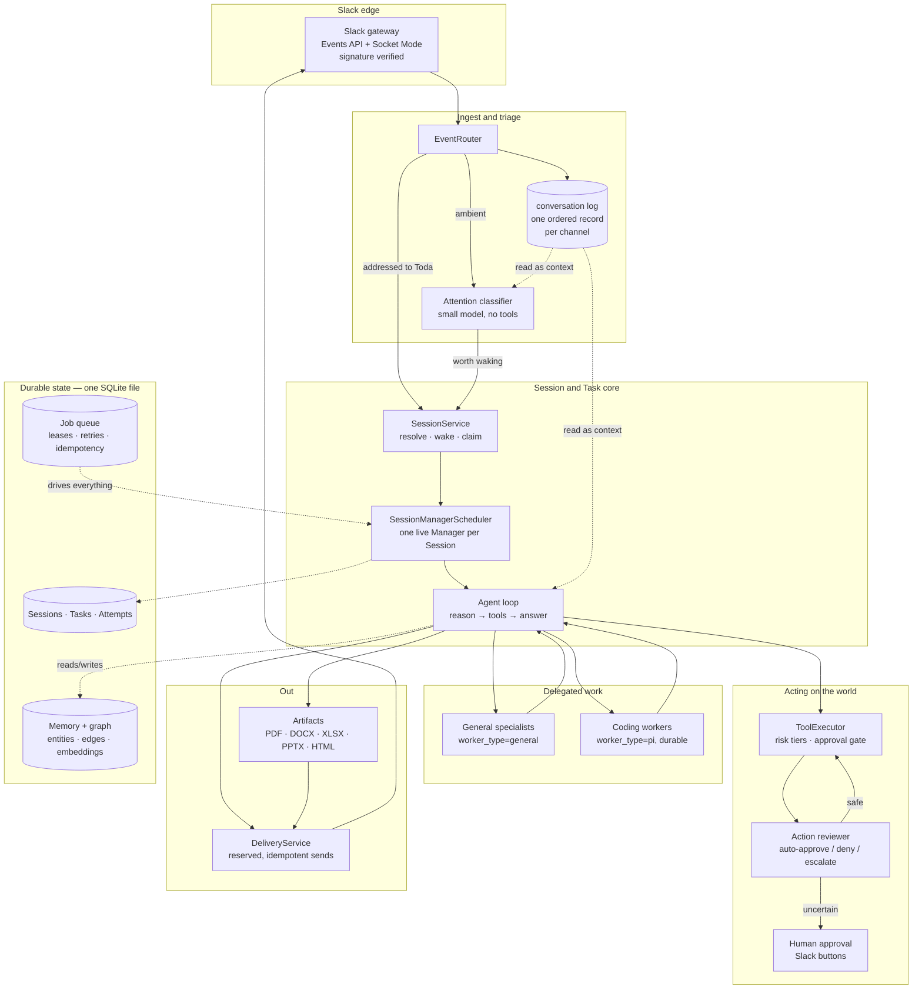

# Toda — Architecture

> **As-built reference.** This describes the system that actually exists in
> `src/toda/`, not a plan for one. Where an earlier design document
> disagrees with this file, this file is correct.
>
> **Naming:** the product is **Toda**. The Python package, CLI, database
> and environment variables are still `toda` / `TODA_*`; renaming the
> internals is deliberately not part of the external rename.

---

## 1. What it is

Toda is a Slack-native company agent. It is not a chatbot wrapper and not
a memory service — it is a durable harness that:

- answers and acts in Slack when addressed,
- observes authorized conversations and decides on its own whether anything
  deserves attention,
- keeps organizational memory (facts, entities, relationships) and cites it,
- delegates substantial work to specialist sub-agents that survive restarts,
- executes real actions through connected apps, behind a permission and
  approval model,
- produces real deliverables (PDF, DOCX, XLSX, PPTX, HTML) as downloadable
  artifacts,
- and runs scheduled/recurring work.

Everything runs on SQLite locally. There is no external queue, cache, or
vector service to stand up.

---

## 2. The shape of the system



---

## 3. Core model: Sessions and Tasks

Two concepts carry the whole runtime.

**Session** — one per conversation (a Slack channel or DM). It owns the
transcript and a *revision counter*. Any new input bumps the revision.
Exactly one **Session Manager** may own a Session at a time, enforced by an
atomic claim with a renewable lease.

**Task** — one unit of agent work, with a `worker_type`:

| `worker_type` | What it is | Lifetime |
|---|---|---|
| `session_manager` | The root Task for a conversational turn. Owns the conversation, decides what to delegate, synthesizes results. | One turn |
| `general` | A specialist doing research / analysis / an action sequence end to end. | Until it returns to its parent |
| `pi` | A coding worker running as a real subprocess, with heartbeats and periodic checkpoints. | Hours; survives restarts |

Tasks form a tree under one root. Children report **only** to their parent —
never directly to Slack. Only the root's synthesized answer is delivered or
captured as memory.

State transitions (`queued → running → waiting_for_* → completed/failed`) go
through atomic, leased writes, so a crashed process is recoverable and two
workers can never execute the same Task.

### Why a message doesn't just "run the agent"

A new Slack message never directly invokes a model. It bumps a Session
revision and enqueues a dispatch job. The scheduler decides whether to start
a fresh root Task, resume a paused one, fold the message into a running Task
as a *steer*, or cancel outright on an explicit stop. This is what makes
follow-ups, interruptions and approvals behave sanely instead of racing.

---

## 4. Ingest and triage

Every inbound Slack event is signature-verified, normalized, and appended to
the **conversation log** — one ordered, append-only record per channel,
covering both inbound messages and everything Toda sends.

That log is the single source of truth for "what was said here". It exists
because the alternative — reconstructing a timeline by joining raw events to
delivery records — produced two real bugs: a Task could be shown a message
that had not been routed to it yet and act on it prematurely, and anything
sent via the `slack_send_message` tool was invisible to Toda's own history.
The log is written at exactly two choke points (inbound routing, outbound
send), so both classes of bug are closed by construction.

From there:

- **Addressed to Toda** (DM, or an explicit mention) → wake the Session
  directly.
- **Ambient** → hand to the **attention classifier**: a small, tool-less
  model that reads a permission-safe slice of context and returns one of
  `IGNORE`, `OBSERVE`, `UPDATE_WORKING_STATE`, `ATTACH_TO_EXISTING_TASK`,
  `ADD_TO_DIGEST`, `WAKE_MAIN_AGENT`, `DM_OWNER`, `ESCALATE_EXISTING_TASK`.
  It is deliberately biased toward staying quiet; a confidence floor and a
  proactivity cooldown sit in front of any unprompted message.

---

## 5. The agent loop

Per iteration: assemble context → call the model → execute tool calls →
record everything → decide whether to continue.

**Prompt assembly** is layered for cache friendliness, and the ordering is
load-bearing: prefix caching matches an exact token prefix, so a single
mutating value early in the request invalidates everything after it. Stable
first — system prompt, then a trusted invocation block (who asked, where,
what limits) —
then conversation context, skills, and company evidence — each in an
explicitly labelled block, with the three genuinely volatile values (the
iteration counter, the tool-call counter and the clock) isolated in a
`<runtime_state>` block at the very end. They previously sat at message #2,
which left the system prompt as the only cacheable thing — about 12% of a
typical 43k-token request; now it is over 99%.

Any tool result Toda did not author itself —
connector actions, browser text, MCP servers, fetched pages, extracted
documents — is wrapped in a framing that marks it as data, never
instructions. The *trusted* half is the named one
(`prompts._TRUSTED_TOOL_NAMES`), so a newly registered tool is framed by
default rather than waived: over-framing costs a few tokens, under-framing
costs an injected instruction run with the company's credentials.

**Skills** are approved procedures — 51 ship built in (research, PDF/report
production, GitHub workflows, meetings, debugging, visual design…). The
model sees the *entire* compatible catalog as name + description and loads
full bodies on demand, rather than a server-side relevance guess deciding
what it's allowed to know about.

**History is scoped, and a tool call never travels without its result.** A
child Task shares its parent's Session, so the unfiltered transcript handed a
root Task every search its specialists ran — the opposite of what delegating
is for, and, because children run concurrently, in an order that interleaved
one child's call with another's. A root now loads the conversation minus
delegated work (`list_session_messages(exclude_delegated=True)`), a child
loads only its own turns, and both trim sites resolve backwards to the
assistant turn that opened a tool group rather than cutting mid-group
(`runtime._tool_safe_head`). A person typing mid-run can still interleave a
turn into a group, so `message_sanitization.repair_tool_call_pairing` is the
backstop on all three transports: results are pulled up to their call, an
unanswered call gets a placeholder, a result answering nothing is dropped.
Getting this wrong is not a degraded prompt — providers reject the request as
`invalid_request`, which `is_permanent_task_error` treats as final, so the
job dead-letters and the conversation goes silent with nothing obviously
wrong in any log.

**Reasoning** uses the provider's native extended-thinking budget on the main
model only; the small auxiliary classifiers don't get it.

**Budgets** bound iterations, tool calls, tokens, and completion size.
Specialists get a much larger envelope than the Manager because they own
whole workflows.

---

## 6. Acting on the world

Tools are typed and carry a risk tier. Reads run freely and in parallel.

The line that decides governance is **whether an action leaves Toda**, not
its risk tier. Writing a PDF into Toda's artifact store, editing its
workspace, updating its memory, scheduling its own automation, cancelling
its own Task — all contained, all reversible, and none of them something a
person can meaningfully consent to without reading the whole task anyway.
Those run directly. Sending an action to a customer's CRM is a different
kind of act, and so is executing code on the host.

The rule is named positively (`_CONTAINED_CAPABILITY_PREFIXES` in
`harness/tools.py`), so a tool carrying an unrecognised capability is gated
rather than waived: wrongly pausing a contained action costs a moment of
friction, wrongly waiving an uncontained one costs an action nobody agreed
to. `connector.*`, `browser.*` and `code.*` are deliberately excluded.

Every gated action passes one front door:

```
gated action
   └─> Action reviewer (auxiliary model)
         ├─ APPROVE  → executes immediately
         ├─ DENY     → blocked, final, no retry
         └─ ESCALATE → Slack approval card (Approve / Deny)
```

The organization's tool-policy mode sets what "gated" resolves to.
`autonomous` (the default) sends uncontained writes to the reviewer above;
`supervised` and `restricted` send them straight to a person; `full_access`
runs ordinary writes directly. A per-tool override in `tool_policies` beats
the mode. Note that under the default mode an automated reviewer, not a
human, is the last thing between the model and a connector write — including
a destructive one.

`request_batch_approval` lets a Task declare its whole plan up front and get
one human decision instead of a pause per action.

**Connected apps** go through Composio: search for the right action in plain
English, fetch its schema, execute it. There are no per-vendor tools —
`COMPOSIO_EXECUTE` is the single path every connector action runs through,
so any toolkit the org connects is reachable the moment it is connected.
GitHub, Linear and the rest are covered by *skills* (how to use them well),
not by bespoke tools.

---

## 7. Durability

A SQLite-backed job queue with leases, exponential retry, dead-lettering and
idempotency keys drives everything. Two properties are worth calling out
because both came from real production failures:

**Three lanes, three pools.** Long agent runs, knowledge work, and fast
infrastructure jobs are leased *and* executed separately, each with its own
thread pool and capacity budget. Sharing one lane meant a 57-second agent
run could hold inbound Slack routing behind it for over a minute; splitting
only the leases fixed head-of-line blocking within a batch but still let a
burst of agent runs occupy every thread, which is the same starvation one
level down. Jobs are also *started* without waiting for the batch to finish,
and leasing is capped at each lane's free capacity, so a job's lease clock
never starts while it waits for a thread.

**Contention is not failure.** A dispatch that finds the Session Manager busy
retries on a short fixed interval, not the exponential error backoff — that
job is the only thing that picks the pending message back up once the Manager
frees, and exponential backoff made follow-ups sit unanswered for minutes
after Toda was already idle.

**Delivery** reserves its idempotency key *before* the send, atomically, and
hands the reservation back if the send fails. Slack does not deduplicate bot
messages, so without this a retry after a partial failure posts twice.

This makes delivery **at-least-once, not exactly-once**, and the distinction
is worth stating plainly: a crash in the window after Slack accepts a message
but before the delivery row is recorded leaves the reservation in `sending`,
and once it goes stale (300s, `_STALE_RESERVATION_SECONDS`) a retry may post
the same message a second time. Closing that window entirely would need a
two-phase commit with Slack, which Slack does not offer. The reservation
bounds duplicates to that one narrow window instead of every retry.

---

## 8. Memory

Ingested content becomes sources → chunks → memories. Retrieval is
permission-filtered at query time and the agent is required to cite source or
memory IDs for company claims.

**The control path and the knowledge path are separate.** Every inbound
event is persisted as canonical evidence — redacted, hashed, versioned — by
a fast, local-only write with no embedding call, no model extraction, no
graph expansion. An explicit per-event policy (`wake_policy`,
`memory_policy`, `group_key`/`group_kind`; `harness/event_policy.py`)
decides, independently of that write, whether to wake the Session Manager
immediately, route through the attention classifier, or not wake at all —
so a slow embedding provider can never delay a Slack reply. Chunking,
embedding, extraction, and episode consolidation run afterward in their own
job lane (`knowledge.index_evidence` / `knowledge.consolidate_episode`),
capacity-isolated from the agent and infrastructure lanes so a burst of
ingest traffic can't starve event routing or dispatch.

**Episodes** group related evidence — a Slack thread, a GitHub issue, a
Linear ticket — into one incrementally-consolidated record with a summary,
a watermark (only sources newer than the last consolidation are ever
re-read), and a hard event/size boundary that closes an episode and opens a
fresh one under the same group key rather than growing forever. An
ambiguous or connector-specific object identifier that can't be resolved
falls back to evidence-only processing instead of guessing at a group.

**Retrieval is unified across three result kinds** — memory, episode, and
raw evidence — through one orchestration entry point (`brain_search` /
`RetrievalService.unified_search`), each authorization-checked before
ranking. Vector search runs on a `sqlite-vec` ANN index (still one SQLite
file, no external service) rather than a brute-force Python scan, which is
also what removed the old fixed "newest 1,000 chunks" cutoff on evidence
search. Graph traversal (`GraphService.neighbors`/`paths_between`) is
authorization-checked edge by edge — an edge backed only by a private
source cannot leak through relationship queries to a destination that
isn't authorized for that source, matching the same rule the graph
explorer already applied.

**Entity/graph population runs two paths, deliberately different in how
cautious they are.** Structured connector data (a GitHub issue, a Linear
ticket) carries real identifiers (an email, a `customer_id`) — a "hard"
identifier is trusted enough to create a new entity outright the first time
it's seen. A plain-text mention in ordinary conversation has no such backing,
so it goes through the same catalog match first, then a stricter three-way
split: an **exact** name/alias match links directly; a **merely similar**
match is never auto-merged — it queues a pending resolution candidate for a
human to confirm; **no match at all** still creates a new entity, because a
mention in conversation is the only signal free-text extraction ever gets,
and refusing to create from it is what left the graph unable to grow anything
beyond people, conversations, sources and tasks. Approving a candidate closes
the loop: the next mention of that name resolves on the fast path instead of
queuing another one.

Memory capture is automatic at Task completion — with one deliberate
exception: a scheduled firing that made no tool calls observed nothing, so it
writes no memory. Without that rule a 3-minute reminder wrote ~480 worthless
memories a day and steadily degraded retrieval for real questions.

---

## 9. Surfaces

- **Slack** — the primary interface. Block Kit for approvals, structured
  replies, and file/artifact links.
- **HTTP API** — 157 routes: sessions, tasks, approvals, memory, graph,
  skills, tools, automations, connections, audit, artifact download.
- **Console** — a React dashboard (Overview, Sessions, Tasks, Approvals,
  Skills, Tools, Graph, Reality, Automations, Connections, Jobs, Policies,
  Audit, Channels, Setup), behind a dashboard account.

### Who sees what in the console

Three things are derived from the signed-in session and never accepted from
the request: the **organization**, the **acting principal** (which decides
what retrieval may touch), and **who decided an approval**. Each was once a
plain parameter, and each was therefore self-asserted.

On top of that, a member sees the Sessions and Tasks they took part in —
transcripts, prompts, tool arguments and results included. Retrieval is
permission-filtered at query time, so without this the Task that *consumed*
that retrieval became a second way to read it. Owner and admin may read any
conversation, and that read is written to the audit log. Mutations require
an admin unless the route explicitly declares itself member-writable, so a
route added without thinking about permissions fails closed.

**Participation is a grant, so only trustworthy sources write it.** Waking a
conversation records you as a participant, and participation is what decides
who may read it back — which makes the write path a grant of the read
permission. `SessionService.wake()` therefore takes `may_join`, defaulting to
False. The platform gateways pass True, because Slack already enforced that
the actor can post in that channel before the event arrived. Nothing else
may: the API and automations can start a new conversation or wake one the
acting principal is already in, and are refused otherwise. API conversation
keys are additionally namespaced `api:{principal_id}:{id}`, so a caller
cannot address a platform conversation's key at all — Slack's is
`slack:{workspace_id}:{channel_id}`, constructible by anyone who knows a
channel id.

## 10. Measuring it

The test suite proves the machinery: leases, idempotency, authorization,
state transitions. It says nothing about whether Toda is *good* — whether
retrieval surfaces the right memory, whether attention stays quiet, whether
an answer is current and safe to send.

`toda-eval` covers those four, against a generated fictional organization
whose facts are pinned in `evals/spec.py` while a model writes the prose.
Corpora and results are not committed; the generator, the labeled cases and
the scorers are. Model-dependent suites run N samples and report spread, so a
change smaller than the sampling noise is reported as noise rather than as a
result. See `docs/EVALS.md`.

---

## 11. Processes

| Command | Role |
|---|---|
| `toda gateway` | API + Slack Socket Mode + the three worker lanes |
| `toda serve` | API and worker lanes, without the Slack connector |
| `toda init` | Create the organization and owner account from `config.json` |
| `toda reindex` | Rebuild the vec0 ANN indexes from stored embeddings |
| `toda retention` | Preview or apply retention cleanup, or delete an organization |
| `toda reset --yes` | Delete **all** local state: database *and* task workspaces |

Toda is one process. The worker lanes are part of the gateway, not a
separately runnable service — there is no way to turn them off and nothing
to run in their place. (An earlier `toda-worker` / `toda-slack` split was
documented here and in the deployment guide long after its entry points and
module were removed; following it produced a gateway that accepted Slack
events and processed no jobs at all.) Only one host may write the SQLite
file, which is what made the split a design question rather than a missing
script.

`toda reset --yes` clears every local table — memory, graph, embeddings,
sessions, tasks, artifacts, conversation log — and the on-disk workspace
tree. It does **not** clear `config.json`, nor remote state (Composio
connections and webhooks, Slack OAuth installs), which live outside this
machine.

---

## 12. Trust boundaries

1. Instructions come only from the user in Slack. Everything reached through
   a tool — web pages, documents, tool output — is data, and is framed as
   such in the prompt.
2. Permissions are resolved per invocation and **re-checked at delivery
   time**, including whether every cited piece of evidence is still
   releasable to that destination.
3. Private evidence is never exposed to a public or unrelated destination.
4. Mid-run steering is trusted only via structural metadata, never because
   some text in a tool result claims to be a steering instruction.
5. Children cannot address Slack; only a synthesized root answer leaves the
   system.
