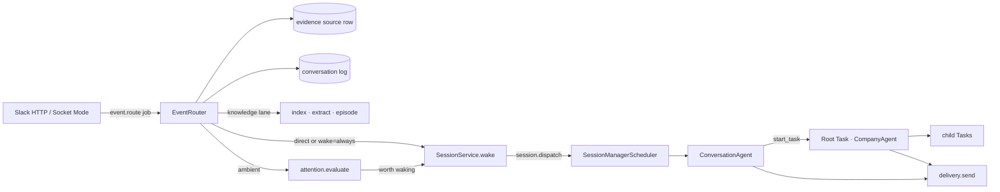

# Toda — Architecture

> **As-built reference, derived from `src/toda/`.** When this file and the
> code disagree, the code is right and this file has a bug. Each section
> names the module that owns the behaviour so it can be checked.

Toda is a self-hosted, Slack-native agent for one organization. It reads the
conversations it is permitted to see, keeps permission-scoped company memory,
answers and acts when addressed, runs longer work as durable Tasks with
specialist children, and gates anything that leaves Toda behind policy and
approval. Everything runs in **one Python process on one SQLite file**.

---

## 1. Process and startup

`toda.main` is the CLI (`[project.scripts] toda = "toda.main:main"`):

| Command | What it does |
|---|---|
| `toda gateway` | Builds one `TodaApp`, starts Slack Socket Mode on a thread when `slack.app_token` is set, registers the Composio webhook when `server.public_url` is set, then serves the API and worker lanes. |
| `toda serve` (also the default with no command) | API and worker lanes without Socket Mode. |
| `toda init [--password]` | Creates the organization and owner dashboard account from `config.json`; prints a generated password once. |
| `toda reindex [--force]` | Rebuilds the `sqlite-vec` ANN tables from the stored JSON embeddings. |
| `toda retention …` | Previews or applies age-based deletion, or deletes an organization. |
| `toda reset --yes` | Deletes the database files and the workspace trees. |

Other entry points: `toda-seed` (synthetic Acme org, `toda.fixtures.seed`) and
`toda-eval` (`evals.runner`).

On startup (`main.lifespan`):

1. `DatabaseOwner` takes an exclusive file lock — only one process may own the
   database.
2. `TodaApp` (`services/container.py`) wires every service. This is the
   composition root; read it to see what depends on what.
3. Old OTel spans past `observability.retention_days` are purged.
4. `IndexingService.backfill()` embeds anything unindexed, including rows whose
   stored vector width no longer matches the current embedding model.
5. Three worker lanes start as asyncio tasks, each pumping `HarnessWorker`
   (`harness/worker.py`) with its own job kinds and thread-pool budget:

| Lane | Job kinds | Budget |
|---|---|---|
| agent | `session.dispatch`, `task.run_child`, `task.pi_poll`, `approval.resolve` | ⅔ of `worker.concurrency` |
| knowledge | `knowledge.index_evidence`, `knowledge.consolidate_episode`, `memory.capture_task`, `skill.curate_task` | `worker.knowledge_concurrency` |
| infrastructure | everything else: `event.route`, `attention.evaluate`, `delivery.*`, … | remainder |

The infrastructure lane also ticks automations (`dispatcher_tick_interval_seconds`)
and, every 30 s, the recovery heartbeat and proactive heartbeat per org.

`pump()` leases no more jobs than a lane has free threads and starts them
without waiting for the batch, so a long agent run never delays Slack routing.

---

## 2. Code map

```
src/toda/
  main.py              CLI, FastAPI app, lifespan, worker lanes
  config.py            config.json schema (pydantic, extra keys rejected)
  providers.py         model provider profiles + role resolution
  runtime_owner.py     single-writer database lock
  slack_socket.py      Slack Socket Mode client
  api/routes.py        every HTTP route (~165) + console SPA serving
  storage/db.py        BrainStore: schema and all SQL (~80 tables)
  domain/models.py     core pydantic models (Source, Memory, Entity, …)
  harness/             the agent runtime
    router.py            EventRouter — inbound event → evidence + wake/attention
    event_policy.py      per-event wake_policy / memory_policy / group key
    attention.py         ambient-message classifier pipeline
    sessions.py          SessionService — resolve, wake, steer, claim, lease
    session_manager.py   SessionManagerScheduler — one live manager per Session
    conversation.py      ConversationAgent — the non-Task conversational turn
    runtime.py           CompanyAgent — the durable Task loop
    child_tasks.py       task_delegate / _parallel / manage / wait tools
    child_task_executor.py, pi_task_executor.py, agent_runner.py
    tools.py             ToolExecutor, native tool registry, approval rules
    typed_tools.py, visual_tools.py, run_code.py, workspace_filesystem.py
    action_review.py     auxiliary-model APPROVE / DENY / ESCALATE
    delivery.py          idempotent Slack delivery
    model_client.py      OpenAI-compatible, Anthropic, Concentrate, deterministic
    prompts.py, prompting/templates/*.txt
    jobs.py, worker.py, recovery.py, automations.py
    memory_capture.py, extraction.py, skill_curator.py, history_compaction.py
    composio.py          connected-app client
  services/            knowledge + platform services
    ingestion.py, indexing.py, embeddings.py, retrieval.py, context.py
    memory.py, graph.py, reality.py (facts, conflicts, cases, judgments)
    authorization.py, scope_resolution.py, policy.py, redaction.py
    skills.py, skill_packages.py, mcp_client.py, workspaces.py, artifacts.py
    proactive.py, signals.py, retention.py, readiness.py, run_inspection.py
    dashboard_auth.py, bootstrap.py, models_catalog.py, web_tools.py
  telemetry/           OpenTelemetry setup + SQLite span exporter
  builtin_skills/      52 SKILL.md procedure packages
web/                   React + Vite + Tailwind operator console
evals/, benchmarks/    quality evals and the 1,000-member benchmark
```

---

## 3. An inbound message, end to end



**Ingress** (`harness/slack.py`). Slack events arrive at `POST /v1/slack/events`
(signature-verified) or through Socket Mode, are normalized into a
`NormalizedEvent`, deduplicated, and queued as `event.route`. Button clicks go
through `accept_interaction` → `approval.resolve`. Signed Composio trigger
webhooks (`POST /v1/composio/webhooks`) enter the same router. `POST /v1/events`
(loopback, or bearer `server.api_keys`) is different: `EventService` ingests
the event as memory only and never wakes an agent.

**Routing** (`EventRouter._route`):

1. Slack attachments are ingested into the event text (`media_ingestion.py`).
2. `resolve_event_policy` decides `wake_policy` (`always` / `attention` /
   `never`) and `memory_policy` (e.g. `episode` with a `group_key` for a Slack
   thread, a GitHub PR, a Linear issue).
3. The event is persisted as redacted, hashed evidence — a fast local write
   with no embedding or model call.
4. It is appended to the **conversation log** (`conversation_messages`), the
   single ordered record of a channel. Outbound sends are appended at the other
   choke point, so Toda's own messages are always in its history.
5. Knowledge jobs are queued, or shed with an audit record if the queue is
   saturated.
6. Direct requests (DM, mention, interactive answer) wake the Session. Ambient
   messages go to `attention.evaluate`.

**Attention** (`harness/attention.py`) runs a small, tool-less model over a
permission-safe slice of context and returns an `AttentionDecision`
(`IGNORE`, `OBSERVE`, `UPDATE_WORKING_STATE`, `ATTACH_TO_EXISTING_TASK`,
`ADD_TO_DIGEST`, `WAKE_MAIN_AGENT`, `DM_OWNER`, `ESCALATE_EXISTING_TASK`).
Anything unprompted must clear `worker.attention_minimum_confidence` and the
per-conversation `worker.proactive_cooldown_seconds`. If an active Task
already owns the conversation, the message is attached to it instead.

---

## 4. Sessions: conversation first, Tasks on demand

A **Session** is one conversation (Slack channel or DM; API conversations are
keyed `api:{principal_id}:{id}`). It has a transcript and a revision counter.

`SessionService.wake()` appends the message, bumps the revision, and either
queues `session.dispatch`, folds the message into an active Task as a
**steer**, or cancels the Task tree on an explicit stop. `wake(may_join=…)`
defaults to False: joining a conversation grants the right to read it back,
so only platform gateways (where Slack already authorized the actor) may add
participants.

`SessionManagerScheduler.dispatch()` atomically claims the Session with a
renewable lease; if another manager holds it, the job retries on a short
fixed interval (contention is not an error). `_run_once` then decides:

| Session state | Action |
|---|---|
| No root Task, or the last one is terminal, reactive trigger | `ConversationAgent.run` — a conversational turn |
| Non-reactive trigger (automation, proactive) or `force_task` | Create a root Task directly |
| Root Task `queued` | `execute_task` |
| Root Task `waiting` on a user | `resume_with_human_message` |
| Root Task `waiting` on children | `resume_for_children` |
| Anything else (running, awaiting approval) | Leave it; the approval flow or a later tick resumes it |

A transient model failure does **not** mark the revision processed, so the
Session stays queued and is retried rather than silently dropped.

**The conversational turn is not a Task** (`harness/conversation.py`). The
model gets a fixed, read-only set of tools that settle a question in a call or
two (`memory_search`, `web_search`, `task_get`, `integration_list`,
`calculate`, …) plus `start_task`. Anything longer — research, connector
actions, artifacts, approvals, delegation — is promoted with `start_task` to a
durable root Task that owns the rest of the work.

---

## 5. Tasks and the agent loop

A Task (`tasks` table) has a `worker_type` and a state:
`queued → running → waiting → completed | failed | cancelled`, with
`waiting_for` naming what it waits on (`user`, `child_task`, approval).
State changes are leased writes (`TaskRunStore`), so two workers never run the
same Task and a crashed process is recoverable.

| `worker_type` | Role |
|---|---|
| `session_manager` | The root Task for a conversation. Owns delegation, synthesis and the answer. |
| `general` | A specialist child (research, analysis, an action sequence). |
| `pi` | A coding child run as a detached `pi` subprocess, polled via `task.pi_poll`, with heartbeats and checkpoints. Only when `agent.pi_coding_enabled`. |

Children are created with `task_delegate` / `task_delegate_parallel`, limited
by `agent.child_max_parallel` and `child_max_depth`, and report only to their
parent. Only a root Task delivers to Slack or is captured as memory.

**`CompanyAgent._loop`** (`harness/runtime.py`), per iteration:

1. Load history: a root sees the Session minus delegated work, a child sees
   only its own turns; trimming never splits a tool call from its result
   (`_tool_safe_head`, plus `message_sanitization.repair_tool_call_pairing`).
2. Budget the request (`context_budget.request_budget`); compact history with
   the extraction model when it crosses the window threshold.
3. Fetch company context (`ContextService.prepare_context`), cached across
   iterations and invalidated after any write-risk tool call.
4. Assemble the prompt (`prompts.py`): stable system prompt and invocation
   block first, then conversation, skills and evidence in labelled blocks, and
   the volatile values (iteration, tool count, clock) last in
   `<runtime_state>` so provider prefix caching survives.
5. Call the main model; deduplicate and execute tool calls; frame every
   untrusted tool result as data (`prompts._TRUSTED_TOOL_NAMES` is the
   allow-list, so a new tool is framed by default).
6. Stop on a final answer, a wait, or a budget (`agent.max_iterations`,
   `max_tool_calls`, `max_model_calls`, `max_cost_usd`, `max_duration_seconds`,
   `max_total_tokens`). Children get larger iteration/tool envelopes.

After a root Task finishes, `_enqueue_post_run_jobs` queues
`memory.capture_task`, `delivery.send`, and `skill.curate_task` when it did
real work. An automation firing with no tool calls is delivered but not
remembered.

**Skills** (`services/skills.py`, `builtin_skills/`) are procedures in
`SKILL.md` form. The model sees the compatible catalog as name + description
and loads bodies with `skill_read`. `skill_propose_create/update` produce
versions that need approval.

---

## 6. Tools and approval

Native tools are registered in `tools.build_tool_registry` and the typed/visual
tool modules; child-task, automation (`automation_*`) and MCP tools are added
in the container. Each has a `risk` (`read` / `write` / `destructive`) and a
`capability_id`.

**What runs without approval** (`tools.runs_without_approval`) is decided by
whether the effect stays inside Toda, not by risk:

- *Contained* capability prefixes run directly: `artifact.`, `automation.`,
  `memory.`, `plan.`, `session.`, `skill.`, `slack.`, `task.`, `workspace.`,
  `web.`, `chart.`, `document.`, … (`_CONTAINED_CAPABILITY_PREFIXES`).
- Always gated even so: `run_code`, `delete_file`, `workspace_publish`,
  `skill_propose_*`, `request_app_connection`, `request_approval`.
- Everything else — `connector.*` (Composio), `mcp.*`, `browser.*`, `code.*`,
  and any unrecognised capability — is gated.

A gated call resolves to an execution path from the org's **tool-policy mode**
(`_mode_default_execution`), overridable per tool in `tool_policies`
(`inherit` / `direct` / `ai_review` / `ask` / `deny`):

| Mode | Read | Write/destructive |
|---|---|---|
| `autonomous` (default) | direct | `ai_review` |
| `supervised` | direct | `ask` (human) |
| `restricted` | ask | ask |
| `full_access` | direct | direct |

`ai_review` sends the call to `ActionReviewer`, an auxiliary model that returns
`APPROVE` (run), `DENY` (final) or `ESCALATE` (Slack Approve/Deny card). Under
the default mode a model, not a person, can be the last check on a connector
write. A Task can also ask a person up front with `request_approval`.

**Connected apps** go through Composio via generic tools —
`integration_list / search / discover / describe / schema / execute` — so any
connected toolkit is usable without per-vendor code. **MCP servers**
configured in the console are exposed as `mcp_<server>_<tool>` tools
(`services/mcp_client.py`, stdio / SSE / streamable HTTP, OAuth supported).

---

## 7. Delivery

`DeliveryService` (`harness/delivery.py`) sends conversation replies, Task
results, failures, acknowledgements, status updates, questions and approval
cards. Before sending it re-checks authorization and that every cited piece of
evidence is still releasable to the destination (`_recheck`,
`_check_disclosure`). The idempotency key is reserved atomically **before** the
send and released if the send fails. A crash between Slack accepting a message
and the row being recorded leaves a `sending` reservation that goes stale after
300 s, so delivery is at-least-once with duplicates confined to that window.

---

## 8. Knowledge: evidence, memory, graph, reality

**Write path.** `IngestionService` stores a source (redacted, hashed,
versioned, scoped). In the knowledge lane, `IndexingService` chunks and embeds
it, `ModelMemoryExtractor` extracts memories when a live model is configured
(deterministic extraction otherwise), and `RealityEngine.ingest_source`
updates the entity graph, bi-temporal facts, fact conflicts and cross-source
cases. `knowledge.consolidate_episode` folds related evidence (a thread, a PR)
into an **episode** summary after `worker.episode_quiet_seconds`.

**Entity resolution** (`services/reality.py`): hard identifiers from connector
data (email, customer id) link or create entities directly; a free-text
mention links on an exact name/alias match, queues a human-reviewed
`entity_resolution_candidates` row on a merely similar match, and creates a new
entity when nothing matches.

**Judgments** record human corrections and are ranked back into later runs
(`judgment_guidance`).

**Read path.** `RetrievalService` searches three result kinds — memories
(`search`), raw evidence chunks (`search_evidence`) and episodes
(`search_episodes`), joined by `unified_search` / the `memory_search` tool.
Each filters by the caller's authorization decision (principal, scope,
purpose, destination) **before** ranking, then fuses FTS5 and `sqlite-vec`
ANN hits. Graph traversal checks authorization edge by edge. `ContextService`
embeds the query once per turn and assembles memories, facts, cases, related
messages and judgment guidance within a token budget.

**Embeddings** (`services/embeddings.py`), chosen by the `embedding` model
assignment:

- OpenAI-compatible remote endpoint.
- `local` — fastembed/ONNX on-device (`uv sync --extra local-embed`).
- Deterministic hash embeddings when nothing is assigned.

Changing the model changes the vector width. Startup backfill re-embeds
mismatched rows, and `toda reindex --force` rebuilds the ANN tables.

---

## 9. Scheduled and background work

- **Automations** (`harness/automations.py`): cron-with-timezone and
  quiet-hours schedules, created by the agent (`automation_create`) or the
  console, fired as `automation`-triggered root Tasks.
- **Recovery heartbeat** (`harness/recovery.py`): requeues running Tasks
  whose lease expired, resumes parents whose children have all finished, and
  re-delivers completed Tasks that never got a delivery.
- **Proactive heartbeat** (`services/proactive.py`): classifies candidate
  triggers into signal types (operational incident, unacknowledged customer
  issue, missing answer, …) and decides whether an unprompted message is
  warranted.
- **Job queue** (`harness/jobs.py`, `harness_jobs`): leases, exponential retry
  for errors, dead-lettering, idempotency keys, per-kind saturation limits.

---

## 10. Models

`ProviderResolver` (`providers.py`) maps **roles** to a provider connection +
model from `models.assignments`: `main`, `attention`, `extraction`,
`tool_summary` (each falls back to `main`), `embedding`, `vision`, and the
media roles `image`, `transcription`, `tts`. Built-in provider profiles: `openrouter`,
`openai`, `anthropic`, `concentrate`, `xai`, `groq`, `deepinfra`, `custom`,
`local`. Clients: OpenAI-compatible chat completions, Anthropic Messages,
Concentrate Responses. Extended reasoning is applied to `main` only.

If `main` has no assignment, every role uses `DeterministicHarnessModel`, so
the full runtime runs offline with no API key. A bundled models.dev snapshot
(`data/models_catalog.json`, refreshed from `models.catalog_url`) supplies
context windows, pricing and modality for model selection.

---

## 11. Configuration

`config.json` is the only configuration file (`config.py`). It is found at
`$TODA_CONFIG`, else the repo root, else the platform data directory. It must
be `chmod 600`, and unknown keys are a hard error. Sections: `server`,
`storage`, `organization`, `models`, `slack`, `composio`, `tools`, `media`,
`agent`, `worker`, `dashboard`, `observability`. `config.example.json` is the
template. The only other environment variable read is `TODA_DB`, which
overrides the database path for the API lifespan.

---

## 12. Surfaces and access control

**HTTP API** (`api/routes.py`) — sessions, tasks, approvals, memory, graph,
facts, cases, judgments, skills, tools, policies, automations, connections,
MCP, jobs, traces, audit, artifacts. `enforce_tenant` runs on every route:

- `/v1/*` requires a dashboard session cookie (unless
  `dashboard.auth_disabled`, which is refused on a non-loopback host).
- The organization and acting principal come from the session, never the
  request; a mismatched `organization_id` is a 403.
- Mutations need owner/admin unless the route is marked member-writable.
- Members read only Sessions/Tasks they participated in; owner/admin reads of
  other conversations are audited.
- `/v1/events` accepts loopback or a bearer `server.api_keys` token.

**Console** (`web/`) — Overview, Sessions, Tasks, Approvals, Policies, Tools,
Skills, Connections, Channels, Automations, MCP, Graph, Reality, Jobs,
Traces, Audit. `pnpm build` writes `web/dist`, which the API serves (or
`src/toda/static/console` in the packaged wheel/container).

**Slack** — replies, Block Kit approval cards and questions, artifact uploads,
acknowledgement reactions.

---

## 13. Storage and observability

One SQLite database (`storage.data_dir/brain.db`, WAL mode) holds everything:
organizations and dashboard auth; sources, chunks, embeddings (JSON columns
plus `vec0` indexes), FTS5 tables; entities, aliases, edges, identifiers;
memories, reality facts, conflicts, cases, judgments, episodes; sessions,
session messages, tasks, attempts, signals, approvals, checkpoints; the job
queue, deliveries, idempotency keys; skills, automations, MCP servers,
artifacts; audit events and OTel spans. Task workspaces live on disk under
`storage.workspace_root` / `agent_workspace_root`.

Telemetry (`telemetry/`) is OpenTelemetry. Spans always go to a SQLite
exporter that feeds the console's Traces and run views, and optionally to OTLP
(`observability.otlp_endpoint`; see `docs/OBSERVABILITY.md`).

---

## 14. Trust boundaries

1. Instructions come from people. Tool output, web pages, documents,
   connector and MCP results are data and are framed as untrusted.
2. Authorization is decided per invocation and re-checked at delivery.
3. Private evidence never reaches a destination not authorized for it.
4. Steering is recognized only from structural metadata, never from text in a
   tool result.
5. Children cannot address Slack; only a root answer leaves the system.
6. `run_code`, browser automation and Pi workers are **not sandboxed** and are
   off by default. See `SECURITY.md`.

---

## 15. Verifying behaviour

- `uv run pytest -q` — machinery: leases, idempotency, authorization, state
  transitions, retrieval, delivery.
- `uv run toda-eval …` — quality (retrieval, attention, answers) against a
  generated organization; see `docs/EVALS.md`.
- `benchmarks/organization_1000.py` — scale baseline; see `docs/BENCHMARKS.md`.
- `scripts/verify_release.py` — release hygiene gate.
