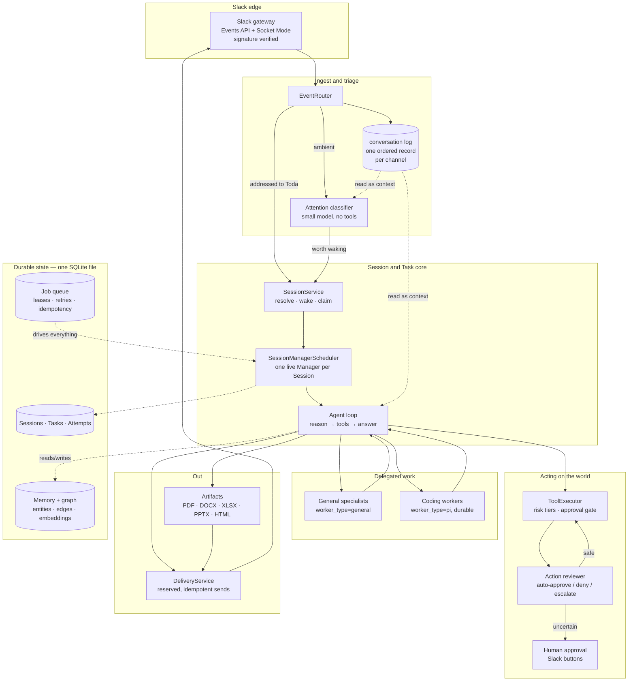

# Toda — Architecture

> **As-built reference.** This describes the system that actually exists in
> `src/toda/`, not a plan for one. Where an earlier design document
> disagrees with this file, this file is correct.
>
> **Naming:** the product is **Toda**. The Python package, CLI, database
> and environment variables are still `toda` / `TODA_*`; renaming the
> internals is deliberately not part of the external rename.
>
> Superseded planning documents (kept for history, not accurate as-built):
> `final_company_wide_agent_harness_architecture.md`,
> `SESSION_MANAGER_TASK_ARCHITECTURE_PLAN.md`,
> `SESSION_MANAGER_TASK_ARCHITECTURE_HANDOFF.md`.

---

## 1. What it is

Toda is a Slack-native company agent. It is not a chatbot wrapper and not
a memory service — it is a durable harness that:

- answers and acts in Slack when addressed,
- observes authorized conversations and decides on its own whether anything
  deserves attention,
- keeps organizational memory (facts, entities, relationships) and cites it,
- delegates substantial work to specialist sub-agents that survive restarts,
- executes real actions through connected apps, behind a permission and
  approval model,
- produces real deliverables (PDF, DOCX, XLSX, PPTX, HTML) as downloadable
  artifacts,
- and runs scheduled/recurring work.

Everything runs on SQLite locally. There is no external queue, cache, or
vector service to stand up.

---

## 2. The shape of the system



---

## 3. Core model: Sessions and Tasks

Two concepts carry the whole runtime.

**Session** — one per conversation (a Slack channel or DM). It owns the
transcript and a *revision counter*. Any new input bumps the revision.
Exactly one **Session Manager** may own a Session at a time, enforced by an
atomic claim with a renewable lease.

**Task** — one unit of agent work, with a `worker_type`:

| `worker_type` | What it is | Lifetime |
|---|---|---|
| `session_manager` | The root Task for a conversational turn. Owns the conversation, decides what to delegate, synthesizes results. | One turn |
| `general` | A specialist doing research / analysis / an action sequence end to end. | Until it returns to its parent |
| `pi` | A coding worker running as a real subprocess, with heartbeats and periodic checkpoints. | Hours; survives restarts |

Tasks form a tree under one root. Children report **only** to their parent —
never directly to Slack. Only the root's synthesized answer is delivered or
captured as memory.

State transitions (`queued → running → waiting_for_* → completed/failed`) go
through atomic, leased writes, so a crashed process is recoverable and two
workers can never execute the same Task.

### Why a message doesn't just "run the agent"

A new Slack message never directly invokes a model. It bumps a Session
revision and enqueues a dispatch job. The scheduler decides whether to start
a fresh root Task, resume a paused one, fold the message into a running Task
as a *steer*, or cancel outright on an explicit stop. This is what makes
follow-ups, interruptions and approvals behave sanely instead of racing.

---

## 4. Ingest and triage

Every inbound Slack event is signature-verified, normalized, and appended to
the **conversation log** — one ordered, append-only record per channel,
covering both inbound messages and everything Toda sends.

That log is the single source of truth for "what was said here". It exists
because the alternative — reconstructing a timeline by joining raw events to
delivery records — produced two real bugs: a Task could be shown a message
that had not been routed to it yet and act on it prematurely, and anything
sent via the `slack_send_message` tool was invisible to Toda's own history.
The log is written at exactly two choke points (inbound routing, outbound
send), so both classes of bug are closed by construction.

From there:

- **Addressed to Toda** (DM, or an explicit mention) → wake the Session
  directly.
- **Ambient** → hand to the **attention classifier**: a small, tool-less
  model that reads a permission-safe slice of context and returns one of
  `IGNORE`, `OBSERVE`, `UPDATE_WORKING_STATE`, `ATTACH_TO_EXISTING_TASK`,
  `ADD_TO_DIGEST`, `WAKE_MAIN_AGENT`, `DM_OWNER`, `ESCALATE_EXISTING_TASK`.
  It is deliberately biased toward staying quiet; a confidence floor and a
  proactivity cooldown sit in front of any unprompted message.

---

## 5. The agent loop

Per iteration: assemble context → call the model → execute tool calls →
record everything → decide whether to continue.

**Prompt assembly** is layered for cache friendliness: a stable system
prompt, then a trusted invocation block (who asked, where, when, budgets),
then conversation context, skills, and company evidence — each in an
explicitly labelled block. Untrusted material (web pages, fetched documents)
is wrapped in a framing that marks it as data, never instructions.

**Skills** are approved procedures — 52 ship built in (research, PDF/report
production, GitHub workflows, meetings, debugging, visual design…). The
model sees the *entire* compatible catalog as name + description and loads
full bodies on demand, rather than a server-side relevance guess deciding
what it's allowed to know about.

**Reasoning** uses the provider's native extended-thinking budget on the main
model only; the small auxiliary classifiers don't get it.

**Budgets** bound iterations, tool calls, tokens, and completion size.
Specialists get a much larger envelope than the Manager because they own
whole workflows.

---

## 6. Acting on the world

Tools are typed and carry a risk tier. Reads run freely and in parallel.
Writes execute immediately for ordinary work. A narrow set is gated: code
execution, automation lifecycle changes, and connected-app actions that are
destructive, financial, or reach an external/customer surface.

Every gated action passes one front door:

```
gated action
   └─> Action reviewer (auxiliary model)
         ├─ APPROVE  → executes immediately
         ├─ DENY     → blocked, final, no retry
         └─ ESCALATE → Slack approval card (Approve / Deny)
```

`request_batch_approval` lets a Task declare its whole plan up front and get
one human decision instead of a pause per action.

Some actions are hardcoded safe and skip the reviewer entirely — for example
a recurring reminder scoped to the requester's own DM, which affects nobody
else and is as easy to stop as to start.

**Connected apps** go through Composio: search for the right action in plain
English, fetch its schema, execute it. Curated shortcuts exist for GitHub and
Linear; any toolkit the org connects is reachable generically.

---

## 7. Durability

A SQLite-backed job queue with leases, exponential retry, dead-lettering and
idempotency keys drives everything. Two properties are worth calling out
because both came from real production failures:

**Two lanes.** Long agent runs and fast infrastructure jobs are leased and
run separately. Sharing one lane meant a 57-second agent run could hold
inbound Slack routing behind it for over a minute. Jobs are also *started*
without waiting for the batch to finish, so one slow job never stalls the
lane it's in. Leasing is capped at free capacity, so a job's lease clock
never starts while it waits for a thread.

**Contention is not failure.** A dispatch that finds the Session Manager busy
retries on a short fixed interval, not the exponential error backoff — that
job is the only thing that picks the pending message back up once the Manager
frees, and exponential backoff made follow-ups sit unanswered for minutes
after Toda was already idle.

**Delivery** reserves its idempotency key *before* the send, atomically, and
hands the reservation back if the send fails. Slack does not deduplicate bot
messages, so without this a retry after a partial failure posts twice.

---

## 8. Memory

Ingested content becomes sources → chunks → memories. Retrieval is
permission-filtered at query time and the agent is required to cite source or
memory IDs for company claims.

**The control path and the knowledge path are separate.** Every inbound
event is persisted as canonical evidence — redacted, hashed, versioned — by
a fast, local-only write with no embedding call, no model extraction, no
graph expansion. An explicit per-event policy (`wake_policy`,
`memory_policy`, `group_key`/`group_kind`; `harness/event_policy.py`)
decides, independently of that write, whether to wake the Session Manager
immediately, route through the attention classifier, or not wake at all —
so a slow embedding provider can never delay a Slack reply. Chunking,
embedding, extraction, and episode consolidation run afterward in their own
job lane (`knowledge.index_evidence` / `knowledge.consolidate_episode`),
capacity-isolated from the agent and infrastructure lanes so a burst of
ingest traffic can't starve event routing or dispatch.

**Episodes** group related evidence — a Slack thread, a GitHub issue, a
Linear ticket — into one incrementally-consolidated record with a summary,
a watermark (only sources newer than the last consolidation are ever
re-read), and a hard event/size boundary that closes an episode and opens a
fresh one under the same group key rather than growing forever. An
ambiguous or connector-specific object identifier that can't be resolved
falls back to evidence-only processing instead of guessing at a group.

**Retrieval is unified across three result kinds** — memory, episode, and
raw evidence — through one orchestration entry point (`brain_search` /
`RetrievalService.unified_search`), each authorization-checked before
ranking. Vector search runs on a `sqlite-vec` ANN index (still one SQLite
file, no external service) rather than a brute-force Python scan, which is
also what removed the old fixed "newest 1,000 chunks" cutoff on evidence
search. Graph traversal (`GraphService.neighbors`/`paths_between`) is
authorization-checked edge by edge — an edge backed only by a private
source cannot leak through relationship queries to a destination that
isn't authorized for that source, matching the same rule the graph
explorer already applied.

**Entity/graph population runs two paths, deliberately different in how
cautious they are.** Structured connector data (a GitHub issue, a Linear
ticket) carries real identifiers (an email, a `customer_id`) — a "hard"
identifier is trusted enough to create a new entity outright the first time
it's seen. A plain-text mention in ordinary conversation has no such backing,
so it goes through the same catalog match first, then a stricter three-way
split: an **exact** name/alias match links directly; a **merely similar**
match is never auto-merged — it queues a pending resolution candidate for a
human to confirm; **no match at all** still creates a new entity, because a
mention in conversation is the only signal free-text extraction ever gets,
and refusing to create from it is what left the graph unable to grow anything
beyond people, conversations, sources and tasks. Approving a candidate closes
the loop: the next mention of that name resolves on the fast path instead of
queuing another one.

Memory capture is automatic at Task completion — with one deliberate
exception: a scheduled firing that made no tool calls observed nothing, so it
writes no memory. Without that rule a 3-minute reminder wrote ~480 worthless
memories a day and steadily degraded retrieval for real questions.

---

## 9. Surfaces

- **Slack** — the primary interface. Block Kit for approvals, structured
  replies, and file/artifact links.
- **HTTP API** — ~163 routes: sessions, tasks, approvals, memory, graph,
  skills, tools, automations, connections, audit, artifact download.
- **Console** — a React dashboard (Overview, Sessions, Tasks, Approvals,
  Skills, Tools, Graph, Reality, Automations, Connections, Jobs, Policies,
  Audit, Channels, Setup), with Sign in with Slack.

## 10. Processes

| Command | Role |
|---|---|
| `toda gateway` | API + Slack gateway + in-process worker (single-process default) |
| `toda serve` | API only |
| `toda-worker` | Standalone worker, for splitting execution out |
| `toda-slack` | Socket Mode connector |
| `toda reset --yes` | Delete **all** local state: database *and* task workspaces |

`toda reset --yes` clears every local table — memory, graph, embeddings,
sessions, tasks, artifacts, conversation log — and the on-disk workspace
tree. It does **not** clear `.env`, nor remote state (Composio connections
and webhooks, Slack OAuth installs), which live outside this machine.

---

## 11. Trust boundaries

1. Instructions come only from the user in Slack. Everything reached through
   a tool — web pages, documents, tool output — is data, and is framed as
   such in the prompt.
2. Permissions are resolved per invocation and **re-checked at delivery
   time**, including whether every cited piece of evidence is still
   releasable to that destination.
3. Private evidence is never exposed to a public or unrelated destination.
4. Mid-run steering is trusted only via structural metadata, never because
   some text in a tool result claims to be a steering instruction.
5. Children cannot address Slack; only a synthesized root answer leaves the
   system.
