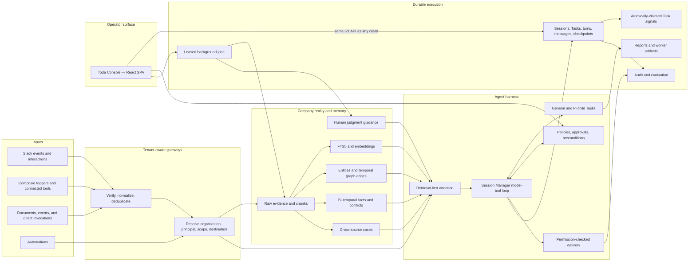

# Toda

**The self-hosted organizational coworker for Slack.**

Toda observes the conversations it is permitted to see, remembers company
decisions, investigates substantial work through durable specialist Tasks,
and requests approval before consequential actions. It gives a team one
accountable coworker instead of a collection of disconnected chatbots.

> **Alpha:** Toda Community is ready for local evaluation and small
> self-hosted pilots. It is not a managed multi-tenant SaaS and must not be
> exposed directly to the public internet. Read [SECURITY.md](SECURITY.md).

## What it looks like

```text
You: What is blocking the Acme renewal?

Toda:
  1. Searches authorized Slack, CRM, tickets, and prior decisions.
  2. Delegates independent CRM and engineering investigations.
  3. Correlates their evidence into one cited briefing.
  4. Offers to update the account plan.
  5. Requests approval before writing to the CRM.
```

The core differences from a desktop automation agent are organizational:

- permission-scoped memory and retrieval;
- one durable Session Manager per conversation;
- restart-safe general and coding Tasks;
- proactive attention to authorized ambient events;
- policy, approval, idempotency, and delivery checks around real actions;
- a complete operator console and audit trail.

## Five-minute local start

Requirements: Python 3.11+ and [`uv`](https://docs.astral.sh/uv/).

```bash
git clone REPOSITORY_URL toda
cd toda
uv sync --extra dev
cp config.example.json config.json   # set organization.owner_email
uv run toda init                     # prints the owner password once
uv run toda gateway
```

Open <http://127.0.0.1:8080> and sign in with the owner account `toda init`
created. With no model configured this runs the deterministic provider, so the
complete runtime can be evaluated without an API key or paid inference.

To use a real model or connect Slack, edit `config.json` and restart the
gateway. That file is the only configuration Toda reads, and nothing writes
to it at runtime.

See [the deployment guide](docs/DEPLOYMENT.md) and
[security policy](SECURITY.md) before changing the loopback-only port binding.

## How Toda is structured

Toda is a company-wide agent harness: one accountable main agent can observe
organizational events, retrieve permission-safe company context, reason with
tools, create bounded child Tasks, request approval for writes, and preserve
what happened as durable organizational memory.

It is not a collection of permanent autonomous agents. Slack, connectors,
automations, and direct API requests all enter the same tenant-aware runtime.
The Session Manager owns the response; child Tasks are durable, independently
leased workers that return evidence to their parent Task.

SQLite is the definitive database for the community implementation. Relational state,
graph nodes and edges, FTS5 indexes, embedding vectors, temporal facts, cases,
agent checkpoints, approvals, artifacts, audit events, and the durable job
queue live in one portable database file.

## Architecture



### Runtime layers

| Layer | Responsibility | Primary modules |
|---|---|---|
| Gateways | Slack Events API, Socket Mode, Composio webhooks, direct events | `harness/slack.py`, `slack_socket.py`, `harness/composio.py`, `api/routes.py` |
| Authorization | Principal, destination, membership, and scope resolution | `services/authorization.py` |
| Agent runtime | Resumable Session Manager and Task model → tool → observation loop | `harness/runtime.py`, `harness/task_run_store.py`, `harness/prompts.py` |
| Tools and actions | Capability-aware schemas, readiness, policy checks, previews, approvals, idempotency | `harness/tools.py`, `harness/typed_tools.py`, `services/policy.py` |
| Skill packages | Immutable file-backed `SKILL.md` procedures, provenance, readiness, and Task-level pinning | `services/skill_packages.py`, `builtin_skills/`, `services/skills.py` |
| Child Tasks | Parallel general or Pi Tasks with inherited scopes and durable attempts | `harness/child_tasks.py`, `harness/child_task_executor.py`, `services/workspaces.py` |
| Retrieval | Permission-filtered lexical, FTS5, vector, graph, fact, case, and Task context | `services/retrieval.py`, `services/context.py` |
| Reality | Connector objects, identity resolution, temporal facts, conflicts, and cases | `services/reality.py` |
| Memory | Atomic memories, temporal revisions, relations, profiles, and extraction | `services/memory.py`, `harness/extraction.py`, `harness/memory_capture.py` |
| Proactivity | Retrieval-first attention followed by deterministic delivery policy | `harness/attention.py`, `services/proactive.py` |
| Durability | SQLite state, leased jobs, retries, artifacts, traces, and audit | `storage/db.py`, `harness/jobs.py`, `harness/worker.py`, `services/artifacts.py` |
| Console | Operator-facing React SPA: dashboard, Session/Task/approval/job inspection, per-tool policy, skill draft approval, automation authoring, and a force-directed graph explorer | `web/src/` |

Built-in and connector procedures are not database-only rows. The authoritative
content lives in validated `src/toda/builtin_skills/**/SKILL.md` packages.
SQLite materializes a tenant-aware index so company skills can be reset or
versioned independently. Each Task resolves mandatory destination skills and
relevant optional skills, checks declared capabilities, and pins the package
hash and instructions into its trace. Use `GET /v1/skills/catalog` to inspect
the package inventory and readiness; the Skills console shows the same view.

### Toda Console

The console (`web/`) is a React, Vite, and Tailwind single-page app served as
static files by the same FastAPI process (`web/dist`, mounted at `/`). It has
no backend of its own and no elevated access — every read and write goes
through the same versioned `/v1/*` API a Slack event, a scheduled automation,
or a direct `curl` invocation would use. Toggling a tool's policy, approving a
skill draft, or creating an automation from the console produces the exact
same schema-validated, policy-checked, audit-logged call as any other client.

Each self-hosted installation belongs to one organization and supports many
dashboard users. The first local setup link creates the organization owner.
After that, people sign in with email and password; owners and administrators
can invite them or approve access requests from **People**. Slack is a data
connection, not a dashboard identity provider. Password hashes use the Python
standard library's memory-hard scrypt implementation, and browser sessions are
opaque, server-side, expiring, and revocable.

Toda binds to localhost by default. For a team deployment, expose the port only
through the organization's VPN or a TLS reverse proxy, set a persistent
`TODA_DASHBOARD_SESSION_SECRET`, and set `TODA_DASHBOARD_COOKIE_SECURE=true`
when the browser reaches Toda over HTTPS. Do not expose the raw HTTP port to the
public internet.

Pages are organized by what they let an operator do, not by data source:

- **Dashboard** — active Tasks, pending approvals, and a permission-scoped
  activity feed, refreshed on a short poll rather than a push channel.
- **Sessions / Session detail** — the primary way to browse conversations. A
  session is one conversation key (a Slack DM or channel). Slack thread
  metadata stays inside its owning channel/DM Session and never creates a
  separate Manager — there is
  no user-facing "start a new session" action, since a session begins
  implicitly the first time someone messages Toda there and every
  subsequent message in that same place reuses it. Session detail shows the
  full transcript plus the list of Tasks it contains, since one
  session commonly spans several Tasks over time. `GET /v1/sessions` and
  `GET /v1/sessions/{id}` back this view.
- **Tasks / Task detail** — inspect a single Task's turns, tool calls, token
  usage, resolved skills, workspace, artifacts, attempts, and child Tasks.
- **Approvals / Tools** — decide pending write approvals; set the
  organization's tool-policy mode, and override any individual tool to run
  directly, go through AI review, always ask a human, or be withheld from
  the model entirely. What the mode governs is actions that *leave* Toda:
  contained writes to its own memory, artifacts, plans, workspace, schedule
  and Tasks run directly in every mode unless a per-tool override says
  otherwise.
- **Skills** — approve or deprecate versioned procedures, with agent-proposed
  drafts surfaced separately from the immutable platform catalog.
- **Integrations / Channels** — review Slack and provider readiness, and
  connect Composio-backed tools through the same hosted OAuth flow Composio's
  API drives everywhere else. Credentials themselves come from `config.json`;
  the console reports what is configured rather than writing it.
- **Automations** — interval or cron-scheduled goals that re-enter the same
  main-agent runtime as any reactive request.
- **Graph** — a force-directed, permission-filtered view of the company graph
  (`/v1/graph/explorer`): nodes sized by connection count, colored by entity
  type, searchable, with a click-to-inspect panel over each entity's edges.
- **Reality / Jobs / Audit** — bitemporal facts and conflicts, the durable
  job queue, and the append-only audit log.

### What a console user can see and do

The organization, the acting principal, and the identity deciding an approval
all come from the signed-in session and are never read from the request.

An ordinary member sees the Sessions and Tasks they took part in — including
transcripts, prompts and tool arguments — plus the approvals they are named
on. Owner and admin see everything, and a cross-participant read is written
to the audit log. Mutations require an admin unless a route declares itself
member-writable: asking Toda to do something, steering or cancelling that
work, deciding an approval you were named on, and the search endpoints.

### How an event becomes action and memory

1. A gateway verifies the event and resolves the organization from trusted
   server-side mappings.
2. The event is normalized and deduplicated before durable ingestion.
3. Raw evidence is stored, chunked, embedded, and linked to its permission
   scope.
4. Extraction produces atomic memories. Reality materialization updates
   connector objects, identifiers, temporal facts, conflicts, and cases.
5. Mentions and DMs activate the main agent. Ambient events first pass through
   retrieval-based attention and proactive policy.
6. Retrieval is authorized before search and again before delivery.
7. The main agent may query memory, use connected tools, or delegate distinct
   independent investigations to up to three child Tasks.
8. Writes require schema validation, policy permission, an approval preview,
   and optional external-state revalidation immediately before execution.
9. Sessions, Tasks, tool results, judgments, artifacts, and post-Task memories are
   persisted for later retrieval.

### Memory and company reality

The harness deliberately keeps several related representations:

- **Raw evidence** preserves the exact source payload and provenance.
- **Chunks and embeddings** provide semantic retrieval.
- **Atomic memories** represent decisions, commitments, issues, outcomes, and
  reusable knowledge.
- **Graph entities and edges** represent people, teams, projects, services,
  customers, ownership, membership, and dependencies. Edges carry the same
  valid-time/system-time split as facts: superseding an edge (ownership
  transferred, on-call rotated) closes its validity window in place rather
  than leaving a stale relationship queryable alongside its replacement, and
  `edges_as_of()` answers "who owned this then?", not only "who owns this
  now?"
- **Bi-temporal facts** answer both “what was true then?” and “what did we know
  at that time?”
- **Conflicts** preserve competing claims instead of silently overwriting them.
- **Cases** correlate related Slack, ticket, code, CRM, and other events into an
  evolving situation.
- **Judgment memory** turns approvals, rejections, corrections, edits, and
  explicit feedback into retrievable guidance. Repeated corrections on the
  same tool or entity reinforce one record instead of accumulating as
  unrelated duplicates, and guidance is ranked by semantic and lexical
  relevance to the current task plus recency — not returned in a flat,
  insertion-ordered list.
- **Artifacts** preserve durable reports and child Task results.

Every representation retains organization and scope boundaries. Retrieval is
always performed for an acting principal and destination.

## What is implemented

- Slack Events API and Socket Mode gateways with signature verification,
  event deduplication, mention/DM activation, channel-scoped sessions, and channel
  policies
- Organization-scoped Composio account discovery, connection links, trigger
  management, signed webhooks, dynamic tool search/describe/execute, and
  historical backfill
- Hermes-style bounded main-agent loop with durable messages, turns,
  checkpoints, resumable human waits, and token/tool/time budgets.
  Abort/steer interrupts are claimed from a dedicated table with the same
  atomic immediate-transaction pattern used for job leasing, so a signal sent
  mid-iteration can't be silently overwritten by the Task's own checkpoint
  write. Exact-duplicate `(tool, arguments)` calls within a single model turn
  are dropped before execution — a model occasionally requests the identical
  call twice, which otherwise burns real tool-call budget for zero new
  information (ported from Hermes's `_deduplicate_tool_calls`)
- A self-improvement pass after every reactive/proactive Task: prompts are
  compared by embedding similarity against other recently completed Tasks —
  something no single Task's own reasoning has visibility into, since
  it only ever sees itself. Detection is pure embedding comparison, no LLM
  call, so it doesn't add to the tool/model call volume it exists to reduce;
  once a pattern repeats often enough to not be a coincidence, it's drafted
  as a skill for human review, never auto-approved
- A React/Vite/Tailwind operator console served by the same process: Task and
  approval inspection, per-tool allow/ask-approval/forbid policy, skill draft
  approval, cron or interval automation authoring, live setup forms for the
  model provider/web tools/Slack, and a force-directed graph explorer — all
  calling the same policy-checked, audit-logged API as any other client
- Dynamic general and Pi child Tasks with inherited scopes, maximum depth one,
  parallelism limits, and durable result artifacts. A worker's tool set is
  whatever the delegating task explicitly named — including write tools —
  not forced read-only; a write call still pauses for the same approval it
  would need from the main agent
- OpenRouter clients for chat, attention, extraction, and embeddings, plus
  deterministic zero-cost providers for tests and local development
- Optional Brave Search and a safe public-page fetch tool; both are read-only,
  and fetched web content is explicitly treated as untrusted evidence
- 51 immutable built-in skill packages with YAML frontmatter, provenance,
  readiness checks, progressive body loading, Slack response validation, and
  company-skill draft/approval workflows
- Root-confined per-Task workspace list/search/read/write/patch/diff tools,
  session search, durable Task plans, explicit Slack actions, and approval-gated
  automation management
- Capability registry and per-Task capability/tool references; deterministic
  calculation, SVG chart creation, and AntV SVG/PNG infographics run natively,
  while typed PDF, DOCX, XLSX, PPTX, OCR, browser, vision, image, and Graphviz diagram contracts report
  `setup_needed` when optional runtimes are absent instead of accepting
  arbitrary paths or shell commands
- Immutable package security scanning, package indexes, workspace expiry and
  scope ownership, and a Task inspector exposing skills, capabilities,
  workspaces, plans, child Tasks, and artifacts
- Permission-filtered hybrid retrieval across evidence, memories, FTS5,
  embeddings, graph relationships, temporal facts, cases, profiles, and Tasks
- Canonical versioned connector objects, per-stream sync cursors, cross-tool
  identifiers, temporal facts, contradiction handling, case correlation, and
  judgment memory. Entity resolution is tiered rather than one flat fuzzy
  threshold: an exact normalized name/alias match short-circuits scoring,
  and a short or low-entropy label is refused rather than trusted — it
  routes to a new entity or a review candidate instead of a confident-looking
  false-positive merge
- Versioned conditional policies, explicit forbids, approval-gated writes,
  idempotency, and execution-time state preconditions
- Retrieval-first proactive attention with opt-in channel policy, confidence
  thresholds, cooldowns, deduplication, and the same main-agent runtime used by
  reactive requests
- Durable leased jobs for consolidation, extraction, profile refresh, reindex,
  backfill, approvals, and automations
- Traces, evaluation metrics, retention controls, tenant deletion, graph
  explorer, and operational control room

## Quick start

Requirements:

- Python 3.11 or newer
- [`uv`](https://docs.astral.sh/uv/)
- Node.js, only to build the console (`web/`)

Install and create the local configuration:

```bash
uv sync --extra dev
cp config.example.json config.json
```

Edit `config.json` — at minimum set `organization.owner_email` — then create
the organization and owner account:

```bash
uv run toda init
```

This prints the generated owner password once. Pass `--password` to choose
your own. Running it against an initialised database is refused rather than
silently reset.

Build the console once (the gateway serves `web/dist` as static files; skip
this and the API still works, just without the UI):

```bash
npm --prefix web install
npm --prefix web run build
```

Start the local gateway:

```bash
uv run toda gateway
```

Set the provider, Slack, and tool credentials in `config.json`, then restart
the gateway; configured Slack Socket Mode starts alongside the API and durable
worker.

`config.json` optionally holds Brave Search and Firecrawl keys under
`tools.connections`. Brave
finds public sources; Firecrawl converts public pages and URL-addressable PDFs
to clean markdown. Without Firecrawl, `web_fetch` uses a safe, read-only direct
fetch fallback; without Brave, the agent does not get web search. Browser
automation, model-generated code execution, and Pi coding workers are optional
high-risk capabilities. `run_code` is bounded and every call is assessed by
the action reviewer, which may approve it without escalating to a person —
only the `supervised` and `restricted` policy modes guarantee a human sees
it first, and neither review nor approval is an OS-level sandbox. Review `SECURITY.md` before enabling these surfaces;
workspace tools remain confined to the configured organizational workspace.

The gateway creates the SQLite database when needed but does not seed demo data.
For a synthetic Acme organization, seed it explicitly:

```bash
uv run toda-seed
```

To remove all local Toda data and start over, stop the gateway and run:

```bash
uv run toda reset --yes
```

This deletes the configured SQLite database and its sidecar files, but does not
touch `config.json` or source code.

Open:

- Toda Console: <http://127.0.0.1:8080/>
- Control room: <http://127.0.0.1:8080/admin>
- Gateway setup: <http://127.0.0.1:8080/setup>
- Graph explorer: <http://127.0.0.1:8080/explorer>
- OpenAPI documentation: <http://127.0.0.1:8080/docs>
- Runtime readiness: <http://127.0.0.1:8080/v1/harness/status>

Toda is one process: the three worker lanes (agent, knowledge,
infrastructure) run inside the gateway and cannot be split out or turned
off. Only one host may write the SQLite file.

## Configuration

Settings are loaded from `config.json`. See `config.example.json` for the
complete template. Unknown keys are rejected rather than silently ignored.

### Minimal offline configuration

No external key is required:

```json
{
  "organization": {"id": "org_acme", "name": "Acme", "owner_email": "you@acme.com"},
  "storage": {"data_dir": "data", "db_name": "brain.db"},
  "models": {"providers": {}, "assignments": {}}
}
```

This mode exercises the complete ingestion, permission, memory, graph, policy,
job, and runtime machinery without paid inference. Its generated agent answers
are deterministic test behavior, not production reasoning.

### Live provider configuration

```json
{
  "models": {
    "providers": {
      "openrouter-company": {"provider": "openrouter", "api_key": "sk-or-..."}
    },
    "assignments": {
      "main":       {"connection": "openrouter-company", "model": "openai/gpt-5.4"},
      "attention":  {"connection": "openrouter-company", "model": "openai/gpt-5-mini"},
      "extraction": {"connection": "openrouter-company", "model": "openai/gpt-5-mini"},
      "embedding":  {"connection": "openrouter-company", "model": "qwen/qwen3-embedding-8b"}
    }
  }
}
```

Omitted auxiliary roles fall back to `main`. Credentials belong to the named
provider connection and are not repeated for embeddings or media models.

The `embedding` role is the one exception to that fallback: it resolves on its
own, and when it is unset retrieval quietly drops to a deterministic local
embedder whose similarity scores are meaningless. Assign it explicitly.

### Browser and media providers

Browser, vision, image generation, transcription, and speech are separate
capabilities. They do not inherit the chat model implicitly. The agent always
sees stable vendor-neutral tools (`vision_analyze`, `image_generate`,
`media_transcribe`, and `text_to_speech`), while deployment configuration owns
the provider and model selection.

Set `models.main_supports_vision` to `true` to pass pixels to the main
multimodal model, or add a `vision` model assignment for a separate model.
Image, transcription, and TTS use `image`, `transcription`, and `tts` model
assignments. Omitting a role disables that capability. Slack
voice files are downloaded and transcribed in the background routing job,
stored in the Slack room's permission scope, and added to the message context.
Distributed Slack installations need the `files:read` OAuth scope.

The browser is enabled with `tools.browser_enabled` and a
`tools.browser_allowed_domains` allowlist. Its snapshot output assigns refs
such as `@e1` for later click/type actions, and it exposes image discovery,
screenshots, console/network logs, dialogs, and vision-assisted inspection.
An optional `browser_cdp` surface is separately gated by
`tools.browser_cdp_enabled` and permits only a small read-only CDP method
allowlist. It drives a real browser against live sites carrying whatever
credentials that browser holds — read `SECURITY.md` first.

Every new source chunk and extracted atomic memory is embedded once. Retrieval
first filters by permission, then combines lexical matching, FTS5, graph
context, and a `sqlite-vec` ANN index. Larger deployments can replace the
indexing implementation while retaining the same authorization and retrieval
service boundaries.

### Runtime and proactivity controls

```json
{
  "agent": {
    "max_iterations": 50,
    "max_tool_calls": 100,
    "context_token_budget": 200000,
    "max_total_tokens": 2000000,
    "child_max_parallel": 3,
    "child_max_depth": 1
  },
  "worker": {
    "poll_interval_seconds": 0.5,
    "concurrency": 30,
    "knowledge_concurrency": 8,
    "attention_minimum_confidence": 0.72,
    "proactive_cooldown_seconds": 900,
    "episode_quiet_seconds": 300
  }
}
```

`worker.concurrency` is the combined budget for the agent and infrastructure
lanes; the agent lane takes two thirds of it. `worker.knowledge_concurrency`
is a separate pool, so an ingest burst cannot starve a Slack reply.

Child Tasks are additionally capped per Task by iterations, tool calls, token
budget, and deadline, and can never delegate further regardless of what a
direct or malformed model call requests — delegation depth is capped at one
independently of tool access. A worker can be granted a write tool by the
delegating task, and that write passes through exactly the same policy,
review and approval path a main-agent write would — no more, and no less.

Approving a write wakes the waiting Task, revalidates its external preconditions,
and executes it once. If a precondition is stale, the Task remains parked with
an explicit failure rather than silently applying an outdated write.

## Slack setup

### HTTP Events API

Configure:

```json
{
  "slack": {
    "signing_secret": "...",
    "bot_token": "xoxb-...",
    "bot_user_id": "U..."
  }
}
```

Expose the API over HTTPS and configure the Slack app:

```text
POST https://your-host/v1/slack/events
POST https://your-host/v1/slack/interactions
```

### Socket Mode for local development

Add an app-level token:

```json
{"slack": {"app_token": "xapp-..."}}
```

Run the unified gateway:

```bash
uv run toda gateway
```

The setup UI creates the installation, identity mapping, and optional first
channel policy. `toda gateway` runs the Slack Socket Mode listener in the
same process as the API; use `toda serve` for the API without it. The
lower-level API equivalents are:

1. The Slack installation with `POST /v1/slack/installations`.
2. Slack-user-to-principal mappings with `POST /v1/identity-mappings`.
3. Channel observation, free-response, and proactive policy with
   `POST /v1/channel-policies`.

DMs and explicit mentions activate the main agent. Channels are proactive by
default: ambient messages are evaluated by attention and may be delivered in
context; a user or policy must explicitly disable proactive delivery for a
channel.

### Single workspace

One gateway serves one Slack workspace, configured directly through
`config.json`. There is no "Add to Slack" OAuth distribution flow: the
credentials in that file are the workspace this gateway talks to, and the
`slack_installations` row mapping workspace to tenant is created automatically
on first connect.

## Optional typed runtimes

The gateway remains lightweight by default. Tool contracts are always present
in the capability catalog, but a missing optional runtime is shown as
`setup_needed` and is not exposed to a model call. Install the supported extras
inside the active environment when needed:

```bash
uv sync --extra dev         # contributor test tooling
uv sync --extra browser     # Playwright (also install its browser binaries)
```

Document tools consume and return Toda artifact IDs; browser tools require an
explicit allowlisted-domain deployment; vision/image tools require provider
flags and credentials. None can access arbitrary host paths or silently bypass
approval. `calculate` and `chart_create` are available in the base install;
`diagram_render` additionally requires the Graphviz `dot` binary to be installed
by the deployment's operating-system package manager. `infographic_create`
uses the pinned local Node runtime under
`src/toda/harness/infographic_runtime`; run `npm install` in that directory
after a fresh checkout. It renders AntV DSL offline into a scoped editable SVG
and a PNG preview suitable for Slack delivery.

## Composio setup

Configure:

```json
{
  "composio": {
    "api_key": "...",
    "webhook_secret": "...",
    "toolkit_versions": "latest"
  }
}
```

The typical onboarding flow is:

1. Read available auth configurations with
   `GET /v1/composio/auth-configs`.
2. Create a hosted authorization link with
   `POST /v1/composio/connections:link`.
3. Import active organization connections with
   `POST /v1/composio/connections:sync`, or register a known connection with
   `POST /v1/connector-accounts`.
4. Assign every connected account an organization, acting principal, and
   memory scope.
5. Discover and create triggers through `/v1/composio/trigger-types` and
   `/v1/composio/triggers`.
6. Configure Composio to deliver webhooks to:

```text
POST https://your-host/v1/composio/webhooks
```

Incoming webhooks are signature checked, timestamp checked, deduplicated, and
resolved to a tenant only through the server-side connected-account registry.
The harness does not trust an organization ID supplied by the webhook payload.

Every outbound Composio action execution resolves both the connected
account's id and its own `composio_user_id` fresh from the connector-account
registry on each call — Composio's execute API rejects a connected account
without the entity id it was linked under, so this pairing is never cached or
assumed from a single default account.

Historical records can be loaded through `POST /v1/connectors/backfill` using
either supplied records or a paginated Composio list action. Backfilled records
follow the same embedding, extraction, identity, fact, conflict, and case path
as live events.

## Organization bootstrap

The demo seed creates an organization, principals, scopes, memberships,
entities, graph relationships, documents, and sample memories. For real data,
bootstrap the organization through the API:

1. Create the tenant with `POST /v1/organizations`.
2. Create permission scopes with `POST /v1/scopes`.
3. Create principals and company objects as graph entities through
   `POST /v1/entities`.
4. Grant scope memberships with `POST /v1/memberships`.
5. Add graph relationships with `POST /v1/edges`.
6. Configure Slack identities, channels, tool policies, and connector accounts.
7. Ingest initial documents/events or start a connector backfill.

Authentication is intentionally outside the current implementation. Until an
identity layer is added, expose these administrative APIs only on a trusted
network.

## Invoke a Session Manager Task

```bash
curl -s http://127.0.0.1:8080/v1/tasks/invoke \
  -H 'content-type: application/json' \
  -d '{
    "organization_id": "org_acme",
    "principal_id": "person_ajay",
    "conversation_id": "api:demo",
    "destination": {
      "type": "internal_agent_session",
      "id": "demo",
      "is_private": true
    },
    "prompt": "Who owns the export worker, what happened recently, and what should we do next?",
    "run_now": true
  }'
```

Inspect the resulting execution with:

```text
GET /v1/tasks/{task_id}?organization_id=org_acme
GET /v1/approvals
GET /v1/harness/jobs
GET /v1/audit/events
```

Relevant company-reality APIs include:

```text
GET      /v1/connectors/objects
GET      /v1/connectors/sync-runs
POST     /v1/connectors/backfill
GET/POST /v1/entities/identifiers
GET      /v1/entity-resolution/candidates
POST     /v1/entity-resolution/candidates/{id}:decide
GET/POST /v1/facts
GET      /v1/fact-conflicts
POST     /v1/fact-conflicts/{id}:resolve
GET      /v1/cases
GET      /v1/cases/{id}/timeline
POST     /v1/cases/{id}:update
GET/POST /v1/judgments
GET/POST /v1/policies
GET/POST /v1/artifacts
```

## Verification

Run the automated suite:

```bash
uv run pytest -q
```

Run the realistic organization simulation:

```bash
uv run python scripts/simulate_org.py
```

Exercise the configured embedding provider:

```bash
uv run python scripts/simulate_org.py --live-embeddings
```

Exercise both embeddings and live reasoning models:

```bash
uv run python scripts/simulate_org.py --live-embeddings --live-models
```

The simulation covers Slack-shaped traffic, signed connector triggers,
historical backfill, retrieval, temporal facts, cases, judgment guidance,
proactive activation and suppression, permission isolation, delivery, memory
capture, job processing, and deduplication.

Current release validation:

- 598 automated tests passing, 1 skipped
- 18/18 deterministic organization simulation checks
- 109 generated API paths

## Data retention

Retention cleanup is a CLI command, not something that runs on its own —
nothing is deleted without an explicit invocation.

```bash
# Dry run: count what's older than 90 days without deleting anything
uv run toda retention --organization-id org_acme --older-than-days 90

# Actually delete it
uv run toda retention --organization-id org_acme --older-than-days 90 \
  --apply --confirmed-by alice@example.com

# Permanently delete an entire organization and all of its data
uv run toda retention --organization-id org_acme \
  --delete-organization --confirm org_acme
```

`--apply` and `--delete-organization` both require an explicit
confirmation flag (`--confirmed-by`, `--confirm=<organization_id>`) so a
bare command is always a preview. The same operations are available over
HTTP at `POST /v1/admin/retention` and the organization-deletion admin
endpoint.

## Deployment boundaries

Toda Community is usable for local evaluation and controlled self-hosted
pilots. It authenticates the console through Slack OpenID or a local
administrator token, authenticates remote ingestion with bearer keys, and
defaults high-risk optional runtimes off. A public or larger deployment still
requires TLS termination, a production secret manager, encrypted backups,
monitoring, and a deployment design appropriate for SQLite's single-host write
workload. Follow [the deployment guide](docs/DEPLOYMENT.md) and
[security policy](SECURITY.md).

Raw evidence is treated as untrusted data, never as instructions. External
mutations remain policy checked, approval gated when required, idempotent, and
auditable.

## Contributing

See [CONTRIBUTING.md](CONTRIBUTING.md) for local setup, the test commands
expected to pass before a PR, and the working principles this codebase holds
to.

Security reports follow [SECURITY.md](SECURITY.md), community behavior follows
[CODE_OF_CONDUCT.md](CODE_OF_CONDUCT.md), and releases follow
[docs/RELEASING.md](docs/RELEASING.md).

## License

[MIT](LICENSE)
