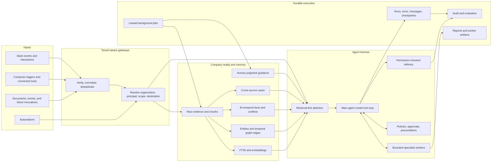

# Docket

Docket is a company-wide agent harness: one accountable main agent can
observe organizational events, retrieve permission-safe company context,
reason with tools, create bounded specialist workers, request approval for
writes, and preserve what happened as durable organizational memory.

It is not a collection of permanent autonomous agents. Slack, connectors,
automations, and direct API requests all enter the same tenant-aware runtime.
The main agent owns the response; specialist workers are ephemeral,
read-only, and return evidence to their parent.

SQLite is the definitive database for this implementation. Relational state,
graph nodes and edges, FTS5 indexes, embedding vectors, temporal facts, cases,
agent checkpoints, approvals, artifacts, audit events, and the durable job
queue live in one portable database file.

## Architecture



### Runtime layers

| Layer | Responsibility | Primary modules |
|---|---|---|
| Gateways | Slack Events API, Socket Mode, Composio webhooks, direct events | `harness/slack.py`, `slack_socket.py`, `harness/composio.py`, `api/routes.py` |
| Authorization | Principal, destination, membership, and scope resolution | `services/authorization.py` |
| Agent runtime | Bounded model → tool → observation loop and resumable states | `harness/runtime.py`, `harness/run_store.py`, `harness/prompts.py` |
| Tools and actions | Schema validation, policy checks, previews, approvals, idempotency | `harness/tools.py`, `services/policy.py` |
| Specialists | Parallel read-only child runs with inherited permissions and budgets | `harness/specialists.py` |
| Retrieval | Permission-filtered lexical, FTS5, vector, graph, fact, case, and run context | `services/retrieval.py`, `services/context.py` |
| Reality | Connector objects, identity resolution, temporal facts, conflicts, and cases | `services/reality.py` |
| Memory | Atomic memories, temporal revisions, relations, profiles, and extraction | `services/memory.py`, `harness/extraction.py`, `harness/memory_capture.py` |
| Proactivity | Retrieval-first attention followed by deterministic delivery policy | `harness/attention.py`, `services/proactive.py` |
| Durability | SQLite state, leased jobs, retries, artifacts, traces, and audit | `storage/db.py`, `harness/jobs.py`, `harness/worker.py`, `services/artifacts.py` |

### How an event becomes action and memory

1. A gateway verifies the event and resolves the organization from trusted
   server-side mappings.
2. The event is normalized and deduplicated before durable ingestion.
3. Raw evidence is stored, chunked, embedded, and linked to its permission
   scope.
4. Extraction produces atomic memories. Reality materialization updates
   connector objects, identifiers, temporal facts, conflicts, and cases.
5. Mentions and DMs activate the main agent. Ambient events first pass through
   retrieval-based attention and proactive policy.
6. Retrieval is authorized before search and again before delivery.
7. The main agent may query memory, use connected tools, or delegate distinct
   read-only investigations to up to three specialists.
8. Writes require schema validation, policy permission, an approval preview,
   and optional external-state revalidation immediately before execution.
9. Runs, tool results, judgments, artifacts, and post-run memories are
   persisted for later retrieval.

### Memory and company reality

The harness deliberately keeps several related representations:

- **Raw evidence** preserves the exact source payload and provenance.
- **Chunks and embeddings** provide semantic retrieval.
- **Atomic memories** represent decisions, commitments, issues, outcomes, and
  reusable knowledge.
- **Graph entities and edges** represent people, teams, projects, services,
  customers, ownership, membership, and dependencies.
- **Bi-temporal facts** answer both “what was true then?” and “what did we know
  at that time?”
- **Conflicts** preserve competing claims instead of silently overwriting them.
- **Cases** correlate related Slack, ticket, code, CRM, and other events into an
  evolving situation.
- **Judgment memory** turns approvals, rejections, corrections, edits, and
  explicit feedback into retrievable guidance.
- **Artifacts** preserve durable reports and specialist results.

Every representation retains organization and scope boundaries. Retrieval is
always performed for an acting principal and destination.

## What is implemented

- Slack Events API and Socket Mode gateways with signature verification,
  event deduplication, mention/DM activation, thread sessions, and channel
  policies
- Organization-scoped Composio account discovery, connection links, trigger
  management, signed webhooks, dynamic tool search/describe/execute, and
  historical backfill
- Hermes-style bounded main-agent loop with durable messages, turns,
  checkpoints, cancellation, resumable human waits, and token/tool/time budgets
- Dynamic specialist workers with inherited scopes, read-only tool subsets,
  maximum depth one, parallelism limits, and durable result artifacts
- OpenRouter clients for chat, attention, extraction, and embeddings, plus
  deterministic zero-cost providers for tests and local development
- Optional Brave Search and a safe public-page fetch tool; both are read-only,
  and fetched web content is explicitly treated as untrusted evidence
- Permission-filtered hybrid retrieval across evidence, memories, FTS5,
  embeddings, graph relationships, temporal facts, cases, profiles, and runs
- Canonical versioned connector objects, per-stream sync cursors, cross-tool
  identifiers, fuzzy entity review, temporal facts, contradiction handling,
  case correlation, and judgment memory
- Versioned conditional policies, explicit forbids, approval-gated writes,
  idempotency, and execution-time state preconditions
- Retrieval-first proactive attention with opt-in channel policy, confidence
  thresholds, cooldowns, deduplication, and the same main-agent runtime used by
  reactive requests
- Durable leased jobs for consolidation, extraction, profile refresh, reindex,
  backfill, approvals, and automations
- Traces, evaluation metrics, retention controls, tenant deletion, graph
  explorer, and operational control room

## Quick start

Requirements:

- Python 3.11 or newer
- The `kys` conda environment
- `uv`

Install and create the local configuration:

```bash
conda activate kys
uv sync --extra dev
cp .env.example .env
```

Start the local gateway:

```bash
uv run docket gateway
```

Open the onboarding UI at <http://127.0.0.1:8080/setup>. It configures
OpenRouter, generates the Slack app manifest, validates local Slack credentials,
maps the workspace to a Docket tenant, and writes only to the local
ignored `.env`. Restart the same command after saving a connection; configured
Slack Socket Mode starts alongside the API and durable worker.

The same local UI optionally accepts Brave Search and Firecrawl keys. Brave
finds public sources; Firecrawl converts public pages and URL-addressable PDFs
to clean markdown. Without Firecrawl, `web_fetch` uses a safe, read-only direct
fetch fallback; without Brave, the agent does not get web search. Browser
automation, shell execution, and general computer control are not part of the
company gateway's trusted tool surface.

The gateway creates the SQLite database when needed but does not seed demo data.
For a synthetic Acme organization, seed it explicitly:

```bash
uv run docket-seed
```

To remove all local Docket data and start over, stop the gateway and run:

```bash
uv run docket reset --yes
```

This deletes the configured SQLite database and its sidecar files, but does not
touch `.env` or source code.

Open:

- Control room: <http://127.0.0.1:8080/admin>
- Gateway setup: <http://127.0.0.1:8080/setup>
- Graph explorer: <http://127.0.0.1:8080/explorer>
- OpenAPI documentation: <http://127.0.0.1:8080/docs>
- Runtime readiness: <http://127.0.0.1:8080/v1/harness/status>

The API starts an in-process durable worker by default. To run API and worker
separately:

```bash
DOCKET_WORKER_ENABLED=false uv run docket
uv run docket-worker
```

## Configuration

Settings are loaded from `.env`. See `.env.example` for the complete template.

### Minimal offline configuration

No external key is required:

```dotenv
DOCKET_DATA_DIR=data
DOCKET_DB_NAME=brain.db
DOCKET_EMBEDDING_PROVIDER=deterministic
DOCKET_MODEL_PROVIDER=deterministic
DOCKET_WORKER_ENABLED=true
```

This mode exercises the complete ingestion, permission, memory, graph, policy,
job, and runtime machinery without paid inference. Its generated agent answers
are deterministic test behavior, not production reasoning.

### Live OpenRouter configuration

```dotenv
OPENROUTER_API_KEY=...

DOCKET_EMBEDDING_PROVIDER=openrouter
DOCKET_EMBEDDING_MODEL=qwen/qwen3-embedding-8b

DOCKET_MODEL_PROVIDER=openrouter
DOCKET_CHAT_MODEL=openai/gpt-5.6-luna
DOCKET_ATTENTION_MODEL=openai/gpt-5.6-luna
DOCKET_EXTRACTION_MODEL=openai/gpt-5.6-luna
```

`DOCKET_EXTRACTION_MODEL` may be omitted; extraction then uses the main
chat model. Model inference and embeddings are offloaded to OpenRouter, so
local compute remains light.

Every new source chunk and extracted atomic memory is embedded once. Retrieval
first filters by permission, then combines lexical matching, FTS5, graph
context, and exact cosine scoring. Exact scoring is appropriate for
development and small pilots. A large deployment should replace that scoring
implementation with `sqlite-vec` or a managed vector index while retaining the
same service boundary.

### Runtime and proactivity controls

```dotenv
DOCKET_AGENT_MAX_ITERATIONS=12
DOCKET_AGENT_MAX_TOOL_CALLS=24
DOCKET_AGENT_CONTEXT_TOKEN_BUDGET=12000
DOCKET_AGENT_MAX_TOTAL_TOKENS=100000

DOCKET_SPECIALIST_MAX_PARALLEL=3
DOCKET_SPECIALIST_MAX_DEPTH=1

DOCKET_WORKER_ENABLED=true
DOCKET_WORKER_POLL_INTERVAL_SECONDS=0.5
DOCKET_WORKER_CONCURRENCY=4

DOCKET_ATTENTION_MINIMUM_CONFIDENCE=0.72
DOCKET_PROACTIVE_COOLDOWN_SECONDS=900
DOCKET_EPISODE_QUIET_SECONDS=300
```

Specialists are additionally capped per task by iterations, tool calls, token
budget, and deadline. They cannot delegate or execute write tools, even if a
direct or malformed model call attempts to bypass their advertised tool list.

## Slack setup

### HTTP Events API

Configure:

```dotenv
DOCKET_SLACK_SIGNING_SECRET=...
DOCKET_SLACK_BOT_TOKEN=xoxb-...
DOCKET_SLACK_BOT_USER_ID=U...
```

Expose the API over HTTPS and configure the Slack app:

```text
POST https://your-host/v1/slack/events
POST https://your-host/v1/slack/interactions
```

### Socket Mode for local development

Add an app-level token:

```dotenv
DOCKET_SLACK_APP_TOKEN=xapp-...
```

Run the unified gateway:

```bash
uv run docket gateway
```

The setup UI creates the installation, identity mapping, and optional first
channel policy. `uv run docket-slack` remains available when you
intentionally want the Slack listener as a separate process. The lower-level
API equivalents are:

1. The Slack installation with `POST /v1/slack/installations`.
2. Slack-user-to-principal mappings with `POST /v1/identity-mappings`.
3. Channel observation, free-response, and proactive policy with
   `POST /v1/channel-policies`.

DMs and explicit mentions activate the main agent. Ambient messages can be
stored and learned without waking it. A channel must explicitly opt into
proactive delivery.

## Composio setup

Configure:

```dotenv
DOCKET_COMPOSIO_API_KEY=...
DOCKET_COMPOSIO_WEBHOOK_SECRET=...
DOCKET_COMPOSIO_TOOLKIT_VERSIONS=latest
```

The typical onboarding flow is:

1. Read available auth configurations with
   `GET /v1/composio/auth-configs`.
2. Create a hosted authorization link with
   `POST /v1/composio/connections:link`.
3. Import active organization connections with
   `POST /v1/composio/connections:sync`, or register a known connection with
   `POST /v1/connector-accounts`.
4. Assign every connected account an organization, acting principal, and
   memory scope.
5. Discover and create triggers through `/v1/composio/trigger-types` and
   `/v1/composio/triggers`.
6. Configure Composio to deliver webhooks to:

```text
POST https://your-host/v1/composio/webhooks
```

Incoming webhooks are signature checked, timestamp checked, deduplicated, and
resolved to a tenant only through the server-side connected-account registry.
The harness does not trust an organization ID supplied by the webhook payload.

Historical records can be loaded through `POST /v1/connectors/backfill` using
either supplied records or a paginated Composio list action. Backfilled records
follow the same embedding, extraction, identity, fact, conflict, and case path
as live events.

## Organization bootstrap

The demo seed creates an organization, principals, scopes, memberships,
entities, graph relationships, documents, and sample memories. For real data,
bootstrap the organization through the API:

1. Create the tenant with `POST /v1/organizations`.
2. Create permission scopes with `POST /v1/scopes`.
3. Create principals and company objects as graph entities through
   `POST /v1/entities`.
4. Grant scope memberships with `POST /v1/memberships`.
5. Add graph relationships with `POST /v1/edges`.
6. Configure Slack identities, channels, tool policies, and connector accounts.
7. Ingest initial documents/events or start a connector backfill.

Authentication is intentionally outside the current implementation. Until an
identity layer is added, expose these administrative APIs only on a trusted
network.

## Invoke the agent

```bash
curl -s http://127.0.0.1:8080/v1/agent/invoke \
  -H 'content-type: application/json' \
  -d '{
    "organization_id": "org_acme",
    "principal_id": "person_ajay",
    "conversation_id": "api:demo",
    "destination": {
      "type": "internal_agent_session",
      "id": "demo",
      "is_private": true
    },
    "goal": "Who owns the export worker, what happened recently, and what should we do next?",
    "run_now": true
  }'
```

Inspect the resulting execution with:

```text
GET /v1/agent/runs/{run_id}
GET /v1/approvals
GET /v1/harness/jobs
GET /v1/audit/events
```

Relevant company-reality APIs include:

```text
GET      /v1/connectors/objects
GET      /v1/connectors/sync-runs
POST     /v1/connectors/backfill
GET/POST /v1/entities/identifiers
GET      /v1/entity-resolution/candidates
POST     /v1/entity-resolution/candidates/{id}:decide
GET/POST /v1/facts
GET      /v1/fact-conflicts
POST     /v1/fact-conflicts/{id}:resolve
GET      /v1/cases
GET      /v1/cases/{id}/timeline
POST     /v1/cases/{id}:update
GET/POST /v1/judgments
GET/POST /v1/policies
GET/POST /v1/artifacts
```

## Verification

Run the automated suite:

```bash
uv run pytest -q
```

Run the realistic organization simulation:

```bash
uv run python scripts/simulate_org.py
```

Exercise the configured embedding provider:

```bash
uv run python scripts/simulate_org.py --live-embeddings
```

Exercise both embeddings and live reasoning models:

```bash
uv run python scripts/simulate_org.py --live-embeddings --live-models
```

The simulation covers Slack-shaped traffic, signed connector triggers,
historical backfill, retrieval, temporal facts, cases, judgment guidance,
proactive activation and suppression, permission isolation, delivery, memory
capture, job processing, and deduplication.

Current release validation:

- 81 automated tests
- 18/18 deterministic organization simulation checks
- 18/18 live OpenRouter embedding simulation checks using
  `qwen/qwen3-embedding-8b`
- 109 generated API paths

## Data retention

Retention cleanup is a CLI command, not something that runs on its own —
nothing is deleted without an explicit invocation.

```bash
# Dry run: count what's older than 90 days without deleting anything
uv run docket retention --organization-id org_acme --older-than-days 90

# Actually delete it
uv run docket retention --organization-id org_acme --older-than-days 90 \
  --apply --confirmed-by alice@example.com

# Permanently delete an entire organization and all of its data
uv run docket retention --organization-id org_acme \
  --delete-organization --confirm org_acme
```

`--apply` and `--delete-organization` both require an explicit
confirmation flag (`--confirmed-by`, `--confirm=<organization_id>`) so a
bare command is always a preview. The same operations are available over
HTTP at `POST /v1/admin/retention` and the organization-deletion admin
endpoint.

## Deployment boundaries

The current build is usable for local development and a controlled small
pilot. Before exposing it as a company-wide production service, add or replace:

- Authentication and trusted principal derivation at the HTTP boundary
- A production secret manager and TLS termination
- An ANN vector index when exact cosine scoring becomes too expensive
- Multi-process deployment design appropriate for the SQLite write workload,
  or managed storage behind the existing interfaces
- Vendor-specific Slack and Composio acceptance tests against the intended
  production installations

The harness intentionally does not expose terminal access, browser automation,
arbitrary code execution, dynamic code loading, or automatic unapproved
production writes. Raw evidence is treated as untrusted data, never as
instructions. External mutations remain policy checked, approval gated,
idempotent, and auditable.
