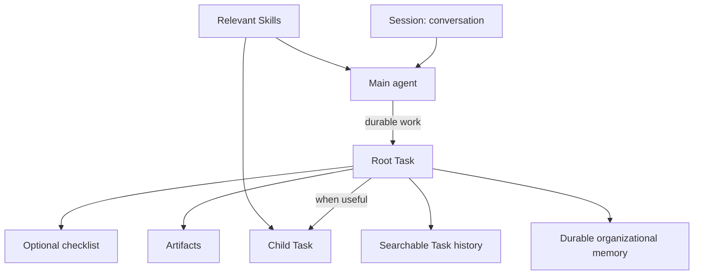
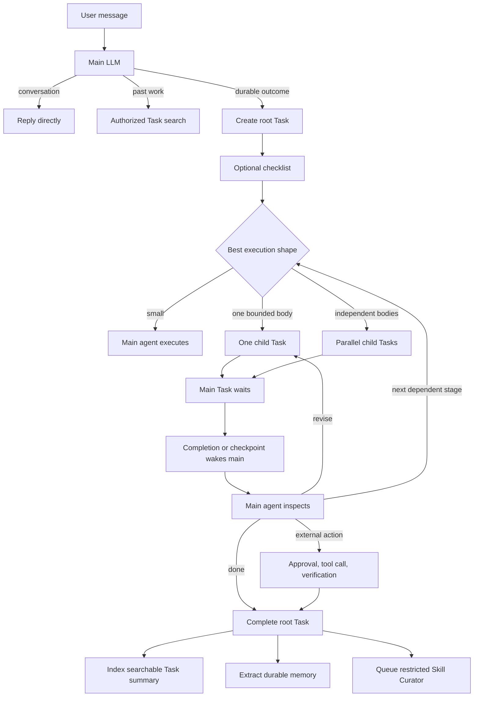

# Toda Harness Restructuring Plan

Status: proposed implementation plan

Scope: agent harness, Tasks, memory, Skills, heartbeats, and Task recall
Out of scope: landing page, onboarding flow, company-site enrichment, and branding

## 1. Objective

Toda should feel like one capable organizational coworker:

- Ordinary conversation remains conversation.
- Durable work becomes a Task only when the main agent decides it needs one.
- The main agent owns the requested outcome.
- The main agent delegates only when delegation provides real value.
- Independent work may run in parallel; dependent work runs sequentially.
- Completed Tasks remain searchable from other authorized Sessions.
- Useful experience can become a reusable Skill through a restricted background curator.
- Long-running work survives process crashes through leases, heartbeats, checkpoints, and retries.
- A small organization `MEMORY.md` is always loaded; detailed memory and Task history are retrieved on demand.

The harness should use the fewest concepts and fields necessary to provide this behavior.

## 2. Core concepts

Toda has five core concepts:

1. **Session** — an ongoing conversation.
2. **Task** — one durable outcome.
3. **Child Task** — a substantial bounded part of a root Task delegated to another agent.
4. **Skill** — reusable instructions describing how to perform a class of work.
5. **Memory** — durable information the organization wants Toda to remember.

Supporting concepts are:

- **Plan** — an optional checklist attached to the root Task.
- **Artifact** — a file produced by a Task.
- **Attempt** — one execution attempt for a Task.
- **Heartbeat** — proof that an execution is still alive.
- **Checkpoint** — a small durable progress snapshot.

There will be no separate Work Item object, planning agent, permanent reviewer agent, agent group chat, or workflow DSL.



## 3. Conversation comes before Tasks

Every direct message or mention begins as a normal conversational turn. Toda invokes the main LLM with recent conversation context, a small organization brief, the requesting user's compact profile, and any active Task summary.

The main LLM may:

- Reply normally.
- Ask a clarifying question.
- Search organizational memory.
- Search past Tasks.
- Continue or steer an active Task.
- Create a new root Task.

A greeting, thanks, acknowledgement, or simple answer does not create a Task.

There will be no deterministic greeting or intent router. The LLM understands the message. The runtime deterministically enforces permissions, approvals, state transitions, retries, and delivery.

### Task promotion

The main agent receives a `start_task` primitive. It calls this when work needs durability because it may:

- Span several meaningful steps.
- Use consequential external actions.
- Need approval or human input.
- Wait for another agent or external event.
- Produce an artifact.
- Need retries or recovery after restart.
- Continue after the current model invocation ends.

The runtime may also require promotion before allowing a durable operation. If the model tries to delegate, schedule, wait, request approval, or perform a consequential write without a Task, the runtime creates or requests a Task boundary before executing it.

Read-only search and a direct answer do not inherently require a Task.

## 4. Root Task

The root Task represents the complete outcome requested by the user.

Example:

> Research the migration, create a PDF, email it to John, verify delivery, and report back.

The main agent owns this outcome until it is completed, cancelled, or genuinely failed.

### Minimal Task data

Required product-level fields:

```text
id
organization_id
origin_session_id
parent_task_id
root_task_id
goal
state
owner_id
origin_scope_id
result
created_at
updated_at
```

Runtime-only details may remain inside an internal metadata payload unless querying them independently becomes necessary. We will not add a dedicated field for every possible condition.

### Task states

Use a small state set:

```text
queued
running
waiting
completed
failed
cancelled
```

When `state=waiting`, a compact `waiting_for` value explains why:

```json
{"type": "child_task", "id": "task_child_1"}
```

Supported waiting reasons initially:

- Child Task
- User response
- Approval
- Timer
- External event

This replaces separate top-level states for every waiting subtype.

## 5. Optional root Plan

The root Task may contain a durable checklist when coordination benefits from it. Small Tasks remain plan-free.

Each Plan item needs only:

```text
id
title
status
depends_on
```

Statuses:

```text
pending
active
blocked
completed
cancelled
```

Example:

```json
[
  {"id": "research", "title": "Research the migration", "status": "active", "depends_on": []},
  {"id": "pdf", "title": "Create and inspect the PDF", "status": "pending", "depends_on": ["research"]},
  {"id": "email", "title": "Email the PDF and verify delivery", "status": "pending", "depends_on": ["pdf"]}
]
```

The Plan is a checklist, not an executable workflow program. The main agent updates it as reality changes. Child Tasks may read it but only the main agent modifies it.

## 6. Delegation

The default is direct execution by the main agent. Delegation is used only when it provides at least one of:

- Context isolation for large intermediate work.
- Specialist instructions or tools.
- Long-running execution that should survive independently.
- Useful parallelism.
- A clean bounded result for the main agent to inspect.

### One child

One child may own an entire substantial sequential body of work:

```text
Root Task
└── Child: research the subject and create the PDF
```

The main agent then inspects the result and performs the email action itself.

### Parallel children

Create several children only when their work is genuinely independent:

```text
Root Task
├── Child: investigate engineering activity
├── Child: investigate customer activity
└── Child: investigate deployment activity
```

### Sequential children

For dependent stages, the main agent delegates one prerequisite, waits, inspects the result, and only then delegates the next stage:

```text
Research child
    ↓
Main-agent inspection
    ↓
Document child, if a separate specialist is actually useful
    ↓
Main-agent inspection
    ↓
Email tool
```

Child Tasks cannot create grandchildren initially. This keeps coordination one level deep and makes ownership clear.

## 7. Main-agent inspection and revision

The main agent checks important child results itself. It may inspect:

- The conclusion.
- Relevant evidence and citations.
- Tool outcomes.
- Produced artifacts.
- Errors, uncertainty, and limitations.

For documents, the main agent uses rendering and inspection tools when visual quality matters.

If a result is inadequate, the main agent sends concrete revision instructions to the same child or creates a replacement child. The revision count is bounded to prevent endless loops.

There is no default reviewer agent. A separate evaluator is not part of this restructuring.

## 8. Tools and external actions

Mechanical actions are tool calls, not child Tasks, unless the action itself represents substantial work.

Examples:

- Send one email.
- Upload one artifact.
- Create one calendar event.
- Post one Slack message.
- Update one CRM record.

The runtime continues to enforce:

- Fresh authorization immediately before execution.
- Approval when policy requires it.
- Idempotency for retried writes.
- Verification after consequential writes when a read-back mechanism exists.

The root Task completes only after the requested action is verified or honestly reported as accepted-but-unverified.

## 9. Task ownership, discovery, and privacy

A Task belongs to an organization. It originates from a Session but is not trapped inside that Session.

`origin_session_id` is provenance, not the sole authorization boundary.

Toda will expose these agent tools:

```text
task_search
task_get
task_continue
task_cancel
```

This enables requests such as:

- “Find the migration Task from last Monday.”
- “Show me the PDF we created.”
- “Continue that customer follow-up.”
- “What happened when we emailed John?”

Every search, inspection, continuation, cancellation, and delivery is re-authorized for the requesting principal and current destination.

Organization-level does not mean organization-public. Private Task titles, summaries, snippets, artifacts, and existence are hidden from unauthorized destinations. Toda must not bridge information from one private channel into another merely because the requester belongs to both.

## 10. Searchable Task history

Completed root Tasks remain first-class searchable history.

The root Task receives a compact completion summary containing:

- Goal.
- Outcome.
- Important completed steps.
- Relevant child conclusions.
- Artifact titles and identifiers.
- People, projects, customers, and services involved.
- Skills used.
- Important errors and recoveries.
- Completion date.

Only root Tasks appear as primary search results. Child Tasks remain inspectable through `task_get` without creating duplicate organization memories.

Index root Task summaries with:

- FTS5 for exact terms, dates, names, and phrases.
- Embeddings for semantic recall.
- Graph relationships for connected people, projects, artifacts, Skills, and future triggers.

Search returns compact results first. Full transcripts, attempts, and tool history load only after the agent selects a Task.

## 11. `MEMORY.md`

Toda will have one organization-scoped `MEMORY.md` containing the small organization brief that should always be available to the main agent.

It contains only stable, organization-public information such as:

- Company name and short description.
- Important products or services.
- Primary timezone.
- Organization-wide terminology.
- A few critical working conventions.
- A few authoritative-source rules that apply broadly.

Example:

```markdown
# Acme

Acme builds infrastructure software for financial operations.
Primary timezone: America/New_York.
GitHub deployment records are authoritative for migration completion.
Customer-facing writing should be concise and evidence-based.
```

Rules:

- Keep it bounded, initially at approximately 4,000 characters.
- Load a frozen snapshot at the beginning of each Session or prompt-cache lifetime.
- Never store secrets, credentials, private-channel facts, raw transcripts, or temporary Task state in it.
- Update it through an explicit, auditable organization-memory operation.
- Detailed facts remain in permission-scoped structured memory and are retrieved on demand.

Toda will not add a global `USER.md`. Individual user identity and preferences remain compact structured profiles, and only the current requester's profile is loaded.

## 12. Structured organizational memory

`MEMORY.md` is not the source of truth for all memory. It is the small always-loaded brief.

Detailed memory continues to store permission-scoped:

- Facts.
- Decisions.
- Commitments.
- Issues.
- Relationships.
- Temporal changes.

After a root Task completes, an asynchronous memory job extracts only durable organizational information from the verified Task outcome. Greetings, generic agent prose, speculative conclusions, and duplicate child summaries are excluded.

Internal evidence links remain necessary for citation, revocation, and privacy. They stay internal and are rendered as human-readable citations. Model prompts and normal UI should not expose opaque source IDs.

## 13. Knowledge graph

Toda retains the existing entity-and-edge graph. A dedicated graph database is not required for this restructuring.

Useful Task relationships include:

```text
Task ABOUT Project
Task REQUESTED_BY Person
Task PRODUCED Artifact
Task USED_SKILL Skill
Task DELIVERED_TO Person
```

Before considering another database, fix current scaling paths:

- Query neighbors directly instead of loading every organization edge.
- Stop scanning every organization entity for every message.
- Add indexed entity and alias candidate lookup.
- Use graph traversal as a retrieval source, not merely decoration after vector search.
- Preserve permission checks during every traversal.

## 14. Skills

A Skill is reusable procedural knowledge. Skills may be:

- Built into Toda.
- Installed from a registry or Git repository.
- Authored by the organization.
- Specific to a device or platform.
- Learned from completed Tasks.

All Skills use one catalog and discovery interface.

Minimal Skill data:

```text
id
name
description
instructions
origin
version
status
scope_id
requirements
```

Statuses:

```text
draft
active
disabled
```

The main agent receives a lightweight authorized Skill catalog and loads full instructions only when useful through `skill_search` and `skill_view`.

A Task may use no Skill, one Skill, or several Skills. Combining existing research and PDF Skills does not automatically justify creating another Skill.

## 15. Skill Curator

Toda adopts Hermes's separate background Skill-review approach without giving the reviewer broad authority.

After a meaningful root Task completes and the user-facing result has been delivered, Toda queues an asynchronous Skill Curator job.

The Curator receives a compact learning packet:

- Task goal and result.
- Root Plan when present.
- Relevant child conclusions.
- Skills and tools used.
- Errors and successful recoveries.
- Explicit user corrections.
- Artifacts and verification results.
- Related past Tasks discovered on demand.

The Curator may:

- Search and inspect authorized completed Tasks.
- Search and inspect Skills.
- Inspect relevant artifacts.
- Create a new Skill draft.
- Create a proposed new version or organization overlay.
- Record that nothing reusable was learned.

It may not:

- Activate Skills.
- Modify an active Skill directly.
- Modify built-in or externally installed Skills.
- Send messages or emails.
- Execute business tools.
- Create recurring schedules.
- Modify unrelated organizational memory.
- Run arbitrary terminal commands.

Curator outcomes:

```text
NO_CHANGE
NEW_SKILL_DRAFT
SKILL_UPDATE_DRAFT
EXISTING_SKILL_COVERS_IT
```

Draft Skills retain links to the Tasks that taught them. An authorized user activates organization or team Skills. Learned private procedures retain their original scope unless explicitly widened through an authorized review.

Built-in and externally installed Skills are never overwritten. Organization-specific improvements become overlays or local version proposals.

## 16. Heartbeats and recovery

### Execution heartbeat

Toda copies the useful Hermes Kanban behavior: a long-running worker periodically proves it is alive and optionally reports a short progress note.

Every Task attempt stores internally:

```text
worker_id
lease_until
last_heartbeat_at
progress
```

The runtime:

1. Atomically claims the Task with a lease.
2. Renews the lease while execution is active.
3. Records heartbeats during long operations.
4. Treats a missing process or stale heartbeat as a lost attempt.
5. Requeues retryable work within a bounded retry policy.
6. Wakes the main agent when a child completes, fails, stalls, or reaches a meaningful checkpoint.

Liveness is not progress. A heartbeat only proves the worker is alive. A checkpoint provides a small durable progress summary that the main agent may inspect.

Apply one heartbeat contract to main-agent Tasks, general child Tasks, and Pi/coding Tasks. Toda already implements portions of this through Task leases and Pi attempt heartbeats; the restructuring unifies the behavior.

### System recovery heartbeat

A cheap system loop periodically checks durable state without invoking an LLM. It handles:

- Expired worker and Session leases.
- Completed children whose parent was not awakened.
- Retryable failed jobs.
- Timed-out approvals or user waits.
- Completed results awaiting delivery.
- Knowledge and Skill Curator backlog.

It wakes an agent only when judgment is required.

### Proactive organization heartbeat

A later harness phase may periodically ask whether new organizational state needs attention. It must be event-aware and watermark-based so it does not run a full LLM turn on an empty interval.

This is separate from worker liveness. It is not required for the initial Task restructuring, and there will be no authoritative `HEARTBEAT.md` in the first implementation. Its rules can be designed after the core Task runtime is stable.

## 17. Main-agent context

The normal main-agent prompt includes only:

- Stable Toda identity and safety rules.
- The organization `MEMORY.md` snapshot.
- The requesting user's compact profile.
- Recent Session turns.
- Active Task summary and Plan, if applicable.
- A lightweight Skill catalog.
- Available tool categories.
- Concise guidance for Task promotion, delegation, and continuation.

It does not preload:

- Full Task history.
- Full organizational memory.
- The entire knowledge graph.
- Full Skill bodies.
- Skill-authoring instructions.
- Every connected tool schema when deferred discovery is possible.

The main agent retrieves deeper context only when necessary.

## 18. Target execution flow



## 19. Implementation phases

### Phase 1 — Conversation and Task separation

- Introduce the conversational turn path.
- Stop creating a root Task for every direct message.
- Give the main LLM `start_task` and active-Task control primitives.
- Permit ordinary replies, clarification, Task search, and memory search without a Task.
- Require Task promotion for durable operations.
- Prevent greeting/acknowledgement turns from entering Task memory or Skill review.

Acceptance criteria:

- “Hi” produces a reply and zero Tasks.
- A simple organizational question can search and answer without a Task.
- A durable multi-step request creates exactly one root Task.
- Existing approval and authorization rules still apply after promotion.

### Phase 2 — Simplify Task lifecycle

- Replace specialized waiting states with `waiting` plus `waiting_for`.
- Keep the root Plan optional and reduce Plan items to the four core fields.
- Preserve root/child Task relationships and one-level delegation.
- Support sequential delegation through wake, inspect, and delegate-next.
- Preserve bounded parallel child dispatch.
- Add bounded child revision behavior.

Acceptance criteria:

- One child can complete an entire sequential body of work.
- Independent children can run concurrently.
- Dependent children never begin before prerequisites pass main-agent inspection.
- The main Task survives process restart while waiting.

### Phase 3 — Unified heartbeat and recovery

- Define one execution-heartbeat contract.
- Apply it to main, general-child, and Pi Task attempts.
- Add stale-attempt reclaim and bounded retries.
- Add progress checkpoints separate from liveness.
- Add the cheap system recovery loop.

Acceptance criteria:

- A healthy long-running worker is not reclaimed.
- A dead or stale worker is detected and safely retried or surfaced.
- Duplicate workers cannot concurrently own the same Task.
- Parent Tasks wake after child terminal states and meaningful checkpoints.

### Phase 4 — Global authorized Task recall

- Add `task_search`, `task_get`, `task_continue`, and `task_cancel`.
- Build root Task completion summaries from the full Task tree.
- Add Task FTS5 and embedding indexes.
- Return compact search results and load details on demand.
- Make Tasks discoverable outside the origin Session when authorized.
- Enforce destination-aware privacy on titles, snippets, artifacts, and details.

Acceptance criteria:

- Toda can find “the migration Task from last Monday.”
- Toda can inspect its artifact and outcome by Task ID.
- An unauthorized channel cannot discover that a private Task exists.
- A permitted user can continue a Task from another Session without duplicating it.

### Phase 5 — Organization `MEMORY.md` and Task memory

- Add bounded organization `MEMORY.md` loading.
- Add audited edit operations and prompt-cache snapshot behavior.
- Ensure it contains only organization-public stable context.
- Aggregate child conclusions into root Task memory capture.
- Keep detailed structured memory permission-scoped and on demand.
- Hide opaque evidence identifiers behind citations.

Acceptance criteria:

- Every Session sees the same bounded organization brief.
- Private facts can never enter `MEMORY.md` automatically.
- Completed Tasks contribute durable facts without duplicating every child transcript.
- Revoked evidence no longer appears in retrieval or citations.

### Phase 6 — Graph and retrieval scaling

- Replace full-edge neighbor scans with indexed SQL queries.
- Replace full-entity message scans with candidate lookup.
- Narrow memory candidates before Python ranking.
- Add graph-first retrieval for relationship questions.
- Link Tasks, artifacts, Skills, people, and projects.

Acceptance criteria:

- Retrieval latency does not grow linearly with every organization edge or entity.
- Relationship questions can be answered from authorized graph paths.
- Graph expansion cannot bypass source and destination permissions.

### Phase 7 — Unified Skill platform

- Unify built-in, installed, organization-authored, device-specific, and learned Skills.
- Preserve origin, version, scope, requirements, and status.
- Add safe installation and validation for external Skills.
- Protect built-in and installed Skills from local mutation.
- Support organization overlays.
- Keep Skill bodies out of the prompt until loaded.

Acceptance criteria:

- The agent discovers all authorized Skill types through one catalog.
- External Skills remain inactive until validated and approved.
- Installed updates do not overwrite organization overlays.
- Tasks record the exact Skill versions used.

### Phase 8 — Skill Curator

- Queue background review after meaningful completed root Tasks.
- Use a configurable, potentially cheaper model.
- Give the Curator only read and draft/proposal tools.
- Compare the Task with related Tasks and existing Skills.
- Create drafts and version proposals with Task provenance.
- Provide an approval surface for promotion.

Acceptance criteria:

- User delivery does not wait for Skill review.
- Most ordinary Tasks may correctly result in `NO_CHANGE`.
- The Curator cannot execute external actions or activate a Skill.
- Repeated or corrected procedures generate grounded, non-duplicative drafts.

### Phase 9 — Proactive organization heartbeat

- Define the minimal events that may warrant proactive attention.
- Use database watermarks and cheap prechecks before invoking an LLM.
- Respect quiet hours, destination policy, cooldowns, and privacy.
- Keep recurring user instructions outside this heartbeat mechanism.

Acceptance criteria:

- Empty intervals consume no LLM calls.
- One state transition is considered once rather than repeatedly.
- Proactive notifications contain only information safe for their destination.
- Disabling proactive heartbeat does not affect worker recovery.

### Phase 10 — Organization-scale validation

Build a synthetic 1,000-person organization and measure:

- Concurrent Session turns.
- Task creation and completion.
- Parallel and sequential child execution.
- Worker heartbeat and stale reclaim.
- Task search latency and authorization.
- Memory and Skill indexing backlog.
- Graph lookup latency.
- SQLite write contention.
- Per-organization fairness and cost.

Only after measurement should Toda decide whether a larger installation needs PostgreSQL, a separate vector service, or a graph projection.

## 20. Existing components to retain

The current harness already has useful foundations that should be simplified rather than replaced:

- Durable Sessions and Session-manager leases.
- Root and child Task records.
- Task execution leases and attempts.
- Child completion wake-ups.
- Pi heartbeats and checkpoints.
- Tool approvals and action review.
- Idempotent job and delivery handling.
- Optional durable Plans.
- Permission-scoped memory capture.
- Temporal entity/edge graph.
- FTS5 and sqlite-vec retrieval.
- Skill catalog, versions, validation, and recurring-pattern drafts.
- Asynchronous knowledge-processing lanes.

## 21. Explicit non-goals

This restructuring will not add:

- A deterministic semantic router.
- A Task for every message.
- A separate Work Item model.
- A planning agent.
- A default reviewer agent.
- Agent group-chat orchestration.
- Child-of-child delegation.
- A general workflow programming language.
- Automatic organization-wide Skill activation.
- A dedicated graph database without measured need.
- A global `USER.md`.
- An initial `HEARTBEAT.md` proactive checklist.
- Branding or onboarding changes.

## 22. Final design rules

1. Conversation is the default; Tasks are promoted durable work.
2. The main agent owns every root Task outcome.
3. Use the fewest agents necessary.
4. Parallelize only independent work.
5. Run dependent work sequentially through main-agent inspection.
6. Use tools for mechanical actions and agents for substantial reasoning work.
7. Keep Plans optional and simple.
8. Make Tasks organization-level but permission-scoped.
9. Keep completed root Tasks searchable across authorized Sessions.
10. Load only a bounded public organization `MEMORY.md` by default.
11. Retrieve detailed memory, Tasks, graph context, and Skill bodies on demand.
12. Use heartbeats for liveness, checkpoints for progress, and the main agent for judgment.
13. Let a restricted background Curator propose Skills without delaying user work.
14. Do not expose internal identifiers or infrastructure language in the normal product experience.
15. Do not add a field, agent, service, or database until a demonstrated behavior requires it.
