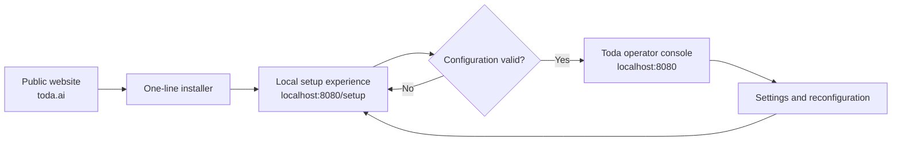
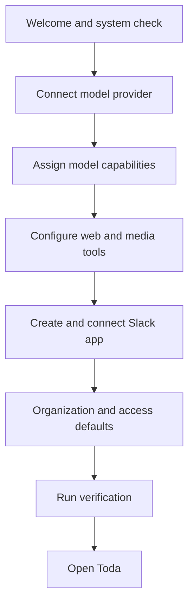

# Toda Product UI and Onboarding Plan

> **Status:** Living planning document — not an as-built specification.
>
> This document records what we have agreed so far and separates those
> decisions from topics that still need discussion. `ARCHITECTURE.md` remains
> the source of truth for the system that exists today.

## 1. Product direction

Toda is intended to become an open-source, self-hosted organizational
coworker: similar in installability to Hermes or OpenClaw, but designed for
organizations rather than a single person's assistant.

The desired experience is:

1. An operator runs one installation command on a Mac, Linux machine,
   Windows machine, or VM.
2. The installer downloads Toda and its dependencies, starts the local
   services, and opens a local setup experience.
3. The operator connects model providers and assigns models to capabilities.
4. The operator configures optional research and media providers.
5. The operator creates and connects one Slack app for one Slack workspace.
6. Toda verifies the complete installation.
7. The operator enters the Toda console and manages the running coworker.

The initial product should prioritize a simple, reliable self-hosted path.
Hosted control planes, multi-install management, and fleet administration are
not required for the first open-source release.

## 2. Agreed product surfaces

Toda has three distinct user experiences, implemented as two UI applications.

| Experience | Application | Audience | Primary job |
|---|---|---|---|
| Public website | Separate static/public web application | Evaluators and prospective adopters | Understand Toda and install it |
| First-run setup | Dedicated mode of the Toda React application | Self-hosting organization administrator | Reach a verified working installation |
| Operator console | Normal mode of the Toda React application | Administrators and operators | Operate, inspect, configure, and govern Toda |
| Settings/reconfiguration | Section of the operator console | Existing administrators | Change a working installation |

This means Toda should not maintain three unrelated design systems. Setup and
the operator console share the same React application, components, tokens,
API client, authentication primitives, and status language. Setup gets its
own full-screen shell and task flow because it serves a different job.



## 3. Public website

The public website remains a separate, independently deployable application.
It is a product and open-source project website, not a remote control panel for
a Toda installation.

Its responsibilities are:

- Explain what Toda is and who it is for.
- Show the Slack-native coworker experience.
- Explain organizational memory, permissions, delegation, approvals, and
  citations in understandable product language.
- Establish open-source and self-hosting trust.
- Display the one-line installation command prominently.
- Link to documentation, GitHub, releases, security information, and the
  community.
- Explain supported operating systems and installation requirements.

It should not contain:

- Provider credentials or configuration forms.
- Organization data.
- Operator login.
- Runtime controls.
- A remotely hosted dashboard for local installations.

The current standalone `landing/index.html` deployment boundary is reasonable.
Its content, information hierarchy, and visual design still need a separate
redesign discussion.

## 4. Installation experience

The intended installation shape follows Hermes/OpenClaw-style onboarding:

```bash
curl -fsSL https://toda.ai/install.sh | bash
```

Windows should receive an equivalent PowerShell command. Package-manager and
container installation options may be added later, but the public website
should lead with one recommended path per operating system.

The installer should:

1. Detect the operating system and architecture.
2. Check or install required runtime dependencies.
3. Download a pinned Toda release and verify its integrity.
4. Create Toda's data, configuration, log, and workspace directories.
5. Create a local service with a clear start/stop/update lifecycle.
6. Start the gateway on localhost.
7. Generate a short-lived first-run bootstrap token.
8. Open the local setup URL automatically when possible.
9. Print the URL and recovery command when a browser cannot be opened.

Example terminal completion:

```text
Toda installed successfully.

Opening setup:
http://127.0.0.1:8080/setup?bootstrap=...
```

The bootstrap token must be temporary and local-only. The administrator must
not be required to sign in with Slack before Slack itself is configured.

## 5. First-run setup experience

Setup uses the Toda React application but has a dedicated full-screen shell.
It should not display the normal operator sidebar before the installation is
ready. Navigation should represent setup progress, not the finished product's
feature inventory.

The setup must be resumable. Closing the browser or restarting Toda must
return the operator to the first incomplete step without losing verified
configuration.



### 5.1 Welcome and system check

Show:

- Installed Toda version.
- Operating system and architecture.
- Data and workspace locations.
- Database readiness.
- Worker/service readiness.
- Writable-directory checks.
- Local port and URL.
- Whether an update is available.

Failures should include direct remediation instead of only reporting that a
dependency is missing.

### 5.2 Connect a model provider

The operator chooses a provider and authenticates once. Initial choices can
include:

- OpenAI
- Anthropic
- OpenRouter
- xAI
- Groq
- DeepInfra
- Custom or local OpenAI-compatible endpoint

The screen should:

1. Explain whether the provider is direct, a gateway, or local.
2. Ask for the provider credential once.
3. Accept a custom base URL when applicable.
4. Test authentication.
5. Load the provider's live model catalog, with curated fallbacks when the
   provider catalog is unavailable.

Toda should not require LiteLLM internally. The provider architecture follows
Hermes's current design: provider profiles, OpenAI-compatible transport where
appropriate, and native protocol adapters where required.

### 5.3 Assign model capabilities

Credentials belong to provider connections. Model roles reference a named
connection and model ID.

Roles currently planned are:

- Main reasoning model
- Attention model
- Extraction model
- Tool-output summarization model
- Embedding model
- Vision model
- Image-generation model
- Speech-to-text model
- Text-to-speech model

The default path must be much shorter than the advanced path. A typical
operator should be able to select a provider and primary model, accept Toda's
recommended assignments, and continue. Advanced operators can customize each
role or connect another provider.

Conceptual configuration:

```yaml
connections:
  openrouter-company:
    provider: openrouter
    credential_ref: secret/openrouter-company

  openai-company:
    provider: openai
    credential_ref: secret/openai-company

assignments:
  main:
    connection: openrouter-company
    model: anthropic/claude-sonnet-4

  embedding:
    connection: openai-company
    model: text-embedding-3-large

  transcription:
    connection: openai-company
    model: gpt-4o-transcribe
```

The same provider credential can serve several model roles without being
entered or stored repeatedly.

### 5.4 Configure web and media tools

Tool providers are configured independently of the main inference provider.
Search and page extraction are separate assignments.

Initial web provider choices include:

- Brave
- Tavily
- Exa
- Firecrawl
- SearXNG
- Direct safe public-page fetching

Other optional capabilities include:

- Browser automation
- Image generation
- Speech-to-text
- Text-to-speech

Optional capabilities should be visibly optional. Setup should not resemble a
wall of required API keys.

### 5.5 Create and connect Slack

The setup should provide:

- A direct link to create a Slack app.
- A copyable Toda Slack manifest.
- Short visual instructions showing where each required value is found.
- Inputs for the bot token, app-level token, and signing secret.
- Immediate credential and workspace validation.
- A summary of the scopes Toda requests and why each is needed.
- A clear statement that one Toda installation initially maps to one Slack
  app and one Slack workspace.

There is no need for a user-facing "app manager" in the first version. An
organization that wants a separate Slack app or workspace can run another
Toda installation. This can be revisited if multi-workspace management becomes
a real requirement.

### 5.6 Organization and access defaults

Ask only for the information needed to enter the product safely:

- Organization name.
- Initial administrator.
- Whether Toda responds only when mentioned or in approved free-response
  channels.
- Optional first channel.
- Conservative starting behavior for observation and proactivity.

Do not force the administrator to design the full permission model during
installation. Advanced channel scopes, private content access, roles,
retention, and proactive behavior belong in the operator console.

### 5.7 Verification

Setup should test the installed system rather than infer readiness from the
presence of credentials.

Verification should include:

- Main model returns a valid response.
- Embedding model returns the configured dimensions.
- Optional assigned models respond through their capability endpoints.
- Web search returns a normalized result.
- Web extraction or direct fetching works.
- Slack authentication identifies the expected workspace and bot.
- Database and workspace directories are writable.
- Background worker is running.
- Required local services survive a restart.

Each test should expose its result and a useful error. Successful completion
ends with one primary action: **Open Toda**.

## 6. Operator console

The operator console is the everyday administrative and observability product.
Once setup is complete, `/` opens the console. Setup remains available through
Settings for reconfiguration.

The current console exposes many internal concepts as equal-weight navigation
destinations. The proposed information architecture is:

```text
Overview

Work
  Tasks
  Sessions
  Approvals

Knowledge
  Company knowledge
  Sources
  Graph

Automate
  Automations
  Skills

Govern
  Access
  Policies
  Audit

Settings
  Model providers
  Tools
  Slack
  Integrations
  MCP
  System
```

Product-language changes to consider:

- Move Jobs into Settings → System or a diagnostics area.
- Replace the internal term Reality with Company knowledge.
- Treat Channels as part of Slack and Access rather than an isolated system.
- Keep Tasks, Sessions, and Approvals prominent because they answer what Toda
  is doing and what requires human attention.

## 7. Relationship between setup and settings

First-run setup and later settings use the same underlying sections and APIs,
but not necessarily the same screen composition.

| Shared capability | First-run presentation | Later settings presentation |
|---|---|---|
| Provider connection | Guided required step | Provider connection registry |
| Model assignments | Recommended defaults first | Full role-by-role editor |
| Web and media tools | Optional guided choices | Tool provider registry |
| Slack | Connect and verify | Workspace status and reconfiguration |
| Organization defaults | Minimal safe choices | Full policies and access controls |
| Verification | End-to-end readiness gate | Individual health tests and diagnostics |

The setup wizard should use the same domain components as Settings rather than
implementing a second set of forms.

The existing React `/setup` page is the foundation to replace. The legacy
`src/toda/static/setup.html` page should remain until the React flow fully
covers local bootstrap and has been verified, then be explicitly retired.

## 8. Product and configuration architecture already agreed

Toda's runtime configuration follows the Hermes provider pattern:

- A provider connection is the credential boundary.
- A model assignment contains a connection reference and model ID.
- Provider profiles describe authentication, base URL, wire protocol, model
  discovery, headers, fallbacks, and provider-specific request behavior.
- Live model discovery is preferred, with curated fallback catalogs.
- OpenAI-compatible Chat Completions are used where appropriate.
- Native Anthropic Messages is supported separately.
- Tool providers such as web search and extraction have their own plugin-like
  configuration surface.
- LiteLLM is not an internal dependency.

Toda-specific additions beyond Hermes include organizational embeddings,
tenant boundaries, channel and private-content scopes, access policies,
retention, auditability, and administrator approvals.

## 9. Credentials and secret storage

The product concept is provider-scoped credentials, not a separate API key for
every model role. The UI should use language such as **provider connection**,
not **vault** or **app management**.

We do not currently need to build a networked secrets-vault product. For the
initial self-hosted release, the operator owns the machine and Toda must store
local secrets securely with restricted filesystem permissions. The UI never
returns stored secret values after saving them.

The implementation details of local encryption, operating-system keychain
integration, container secrets, and headless-server secret injection remain
open and require a security-focused design decision.

## 10. Scale and organizational access

The onboarding and UI must remain usable for organizations with roughly one
thousand members. This affects background synchronization, indexes, pagination,
search, channel selection, policy assignment, and verification time.

However, first-run setup should not wait for a complete import of every member,
channel, message, and connected source. Setup should establish a functioning
workspace, then show background synchronization progress in the console.

The following access questions are important but intentionally secondary to
the first onboarding redesign:

- Public channels versus private channels.
- DMs and group DMs.
- Membership-derived access.
- Channel-specific observation and response rules.
- Connected-source permissions.
- Whether retrieved information may be used in another channel.
- Changes in membership and revocation.
- Administrator visibility into sensitive activity.

These require a separate permissions and organizational-access design.

## 11. Design direction agreed so far

The inferred design brief accepted for continued planning is:

- **Audience:** self-hosting organization administrator.
- **Primary use case:** get Toda working safely in approximately ten minutes.
- **Tone:** technical and utilitarian, with enough warmth that setup does not
  feel like infrastructure documentation.

The public website may use a more expressive version of Toda's identity. Setup
and the console should prioritize clarity, truthful system state, progressive
disclosure, and repairable errors.

The current interfaces do not yet feel like one product:

- The landing page is dark, sharp, and monospace-led.
- The React console is light, rounded, and pine-and-acid.
- The legacy setup page has a third editorial visual language.

A future design-system discussion must decide which identity becomes canonical
and how it adapts between marketing, onboarding, and operations without making
the three surfaces visually identical.

## 12. Explicitly open questions

The following items are not decided yet.

### Distribution and lifecycle

- Exact installer implementation for macOS, Linux, and Windows.
- Whether Docker is an equal installation path or an advanced alternative.
- Upgrade channels, rollback, uninstall, and data preservation behavior.
- Whether Toda runs as a system service, user service, container, or selectable
  option.
- Offline installation and air-gapped organization support.

### Setup architecture

- Exact persistence format for resumable setup progress.
- How the bootstrap administrator token is generated, expires, and recovers.
- Whether setup can be served on a non-local interface for headless VMs.
- Secure access to setup through SSH forwarding or an operator-provided public
  URL.
- Which steps are mandatory versus skippable.
- Recommended model bundles per provider and how recommendations are updated.

### Credentials

- Plain restricted local file versus encrypted local store.
- Operating-system keychain support.
- Docker/Kubernetes secret mounting.
- Credential rotation and health reporting.
- Multiple credentials for one provider and failover behavior.

### Slack and installations

- Whether the first release strictly enforces one installation, one Slack app,
  and one workspace.
- Reinstallation, token rotation, and workspace migration.
- Slack Marketplace distribution versus manual app creation.
- Future Teams or other chat-platform onboarding.

### Organizational access

- Public, private-channel, DM, and group-DM authorization model.
- Initial data-sync boundaries.
- Default observation and proactivity policies.
- Administrator and member roles.
- SSO, SCIM, directory sync, and enterprise identity.
- Retention and deletion defaults.

### Product UI

- Final canonical Toda visual identity.
- Landing-page information architecture and copy.
- Exact setup navigation and screen-level wireframes.
- Dashboard homepage priorities and metrics.
- Mobile and tablet expectations for administrators.
- Empty, loading, failure, degraded, update, and recovery states.
- Accessibility target and verification process.
- Whether advanced diagnostics are visible by default or behind an expert mode.

### Open-source project

- Repository structure for the public website, product UI, installer, and core.
- Documentation site and contribution experience.
- Release artifacts and supported-platform matrix.
- License and third-party notices for architecture or code adapted from Hermes.
- Governance, security response, plugin ecosystem, and compatibility policy.

## 13. Proposed discussion order

To avoid designing screens before their behavior is known, continue planning
in this order:

1. Installation and process lifecycle.
2. Setup state machine and bootstrap security.
3. Recommended versus advanced provider/model configuration.
4. Slack creation and verification journey.
5. Organizational access defaults.
6. Operator-console information architecture.
7. Canonical Toda visual identity and design system.
8. Screen-level wireframes and implementation plan.

## 14. Current implementation note

Implemented in August 2026:

- A one-line macOS/Linux installer and equivalent PowerShell installer use the
  released `toda-ai` package and create a per-user login service.
- `toda service` provides install, start, stop, restart, status, and update
  lifecycle commands. The service runs the single database-owning gateway.
- The installer issues a digest-stored, one-use, 30-minute bootstrap token and
  opens the localhost setup route.
- The React setup route has its own full-screen progress shell and is usable
  before Slack login. Write endpoints require the bootstrap session or an
  authenticated organization operator.
- Setup is derived from durable configuration and therefore resumes at the
  first incomplete step after a restart.
- Provider credentials belong to named provider connections. Model roles store
  only connection and model ID. Model discovery, optional web/media providers,
  Slack manifest creation, workspace validation, organization creation, and
  installation verification are available in the flow.
- The operator console uses work, knowledge, automation, governance, and
  settings domains; heavy graph/chart routes are code-split.
- The standalone landing page now uses an editorial organization-map
  composition and publishes the recommended install commands.

The remaining items in this document's open-questions section are future
distribution choices, not blockers for the self-hosted single-workspace V1.
